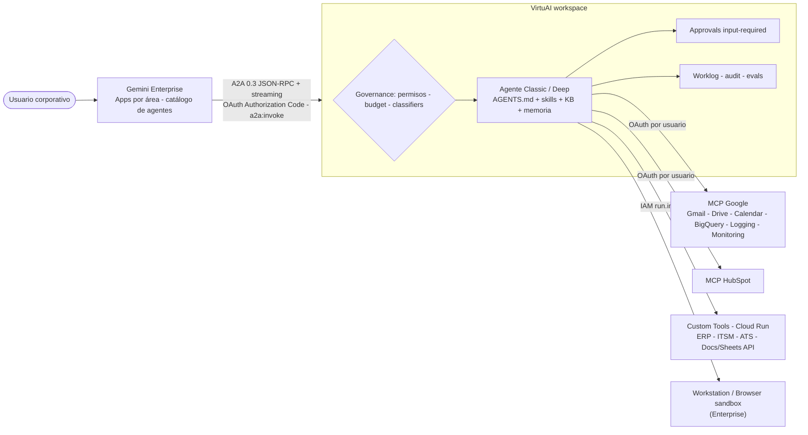

# Agentes GE - Agent Harness Kits para VirtuAI

Kits de implementación para los **26 agentes** del marketplace *Agentes GE*, diseñados para ejecutarse en **VirtuAI** (runtime de agentes) y exponerse en **Gemini Enterprise** vía **A2A**.

## Arquitectura de referencia

## Qué es el "Agent Harness Kit"

En VirtuAI cada agente corre sobre un **harness** (Classic o Deep). El kit reúne todo lo que hay que configurar:

| Pieza | Archivo | Importable por Git en VirtuAI |
|---|---|---|
| System prompt (rol, alcance, reglas, tools, formato) | `AGENTS.md` (front matter `name`/`description`) | Sí: carpeta con `AGENTS.md` = agente |
| Skills (Deep) | `skills/<nombre>/SKILL.md` | Sí: carpeta con `SKILL.md` = skill del agente superior |
| Configuración (modelo, capacidades, memoria, canales, seguridad, publicación, budget) | `harness/agent-config.yaml` | No: referencia para la UI |
| Reglas con capa de enforcement | `harness/rules.md` | No (se aplican en prompt, Ask, classifiers, IAM) |
| Tools (manifiesto + Custom Tools campo a campo) | `harness/tools/` | No: formulario New Tool / MCP Servers |
| Knowledge Base (documentos + parámetros RAG) | `harness/knowledge-base.yaml` | No: Build → Knowledge Base |
| Evaluaciones (golden + negativos, scorers) | `harness/evals/eval-dataset.json` | No: Monitor → Evaluations |
| Agent Card A2A de referencia | `harness/a2a/agent-card.example.json` | No: usar la card real publicada |
| Diagramas mermaid (inputs, configuración, tools, outputs) | `ARCHITECTURE.md` | — |

> **Import por Git** (Enterprise - Build → Repositories): VirtuAI convierte cada carpeta con `AGENTS.md` en un agente (borrador, etiqueta `imported`, sin canales) y cada carpeta con `SKILL.md` en una skill del agente superior. Los nombres de skills son **únicos por workspace** (este repo no tiene duplicados). Los agentes Classic no admiten skills, por eso sus procedimientos están en `harness/procedures/` y embebidos en `AGENTS.md`. El resto de `harness/` no se importa: es la guía de configuración en la UI.

## Catálogo

Complejidad e impacto en escala 1-5 (rúbrica en [SCORING.md](SCORING.md)).

### Dirección

| Agente | Harness | Acceso | Complejidad | Impacto | Skills | Tools | Conectores |
|---|---|---|---|---|---|---|---|
| [Executive Intelligence](agentes/executive-brief/README.md) | Deep | Lectura | 2 | 4 | `executive-report`, `kpi-variance-explainer`, `decision-log-tracker` | 4 | BigQuery, Drive, Gmail |
| [Strategic Opportunity Radar](agentes/strategy-radar/README.md) | Deep | Lectura | 3 | 3 | `strategic-radar`, `market-signal-scan`, `initiative-prioritization` | 4 | Drive, BigQuery, Gmail |

### Ventas

| Agente | Harness | Acceso | Complejidad | Impacto | Skills | Tools | Conectores |
|---|---|---|---|---|---|---|---|
| [Sales CRM Copilot](agentes/sales-copilot/README.md) | Deep | Escritura con aprobación | 3 | 5 | `sales-followup`, `deal-risk-review`, `crm-update-approval` | 5 | HubSpot, Gmail, Calendar |
| [Lead Qualification Agent](agentes/lead-qualification/README.md) | Deep | Escritura con aprobación | 3 | 4 | `lead-scoring`, `icp-fit-explainer`, `lead-routing` | 5 | HubSpot, BigQuery, Gmail |
| [Commercial Proposal Studio](agentes/proposal-builder/README.md) | Deep | Escritura con aprobación | 4 | 4 | `proposal-writing`, `scope-estimator`, `pricing-guardrail` | 5 | HubSpot, Drive, Google Docs, BigQuery |

### Marketing

| Agente | Harness | Acceso | Complejidad | Impacto | Skills | Tools | Conectores |
|---|---|---|---|---|---|---|---|
| [Campaign Launch Copilot](agentes/campaign-copilot/README.md) | Deep | Escritura con aprobación | 4 | 3 | `campaign-planning`, `copy-variants`, `compliance-check` | 5 | HubSpot, Drive, Google Sheets, Gmail |
| [Marketing Performance Analyst](agentes/marketing-analytics/README.md) | Classic | Lectura | 2 | 3 | `campaign-attribution`, `metric-variance` | 3 | HubSpot, BigQuery, Google Sheets |

### Clientes

| Agente | Harness | Acceso | Complejidad | Impacto | Skills | Tools | Conectores |
|---|---|---|---|---|---|---|---|
| [Customer Support Resolver](agentes/support-resolver/README.md) | Deep | Escritura con aprobación | 4 | 5 | `support-resolution`, `escalation-triage`, `refund-policy-check` | 5 | HubSpot, Drive, Gmail, API / Cloud Run |
| [Customer Success Health](agentes/customer-health/README.md) | Deep | Lectura | 3 | 4 | `customer-health`, `renewal-prep`, `churn-signal-review` | 4 | HubSpot, BigQuery, Gmail |

### Talento

| Agente | Harness | Acceso | Complejidad | Impacto | Skills | Tools | Conectores |
|---|---|---|---|---|---|---|---|
| [Employee Onboarding Navigator](agentes/onboarding-agent/README.md) | Deep | Escritura con aprobación | 4 | 3 | `employee-onboarding`, `access-request-builder`, `first-week-plan` | 4 | Drive, Gmail, Calendar, API / Cloud Run |
| [People Policy Advisor](agentes/people-policy/README.md) | Classic | Lectura | 1 | 4 | `policy-answer`, `policy-gap-escalation` | 2 | Drive, Google Docs |
| [Talent Selection Evidence Analyst](agentes/talent-selection/README.md) | Deep | Escritura con aprobación | 5 | 3 | `cv-competency-review`, `bias-safeguard`, `interview-guide` | 6 | Drive, Google Docs, Google Sheets, API / Cloud Run |

### Finanzas

| Agente | Harness | Acceso | Complejidad | Impacto | Skills | Tools | Conectores |
|---|---|---|---|---|---|---|---|
| [Accounts Payable Reviewer](agentes/invoice-review/README.md) | Deep | Escritura con aprobación | 5 | 5 | `invoice-matching`, `vendor-bank-change-alert`, `duplicate-invoice-check` | 5 | Drive, BigQuery, Gmail, API / Cloud Run |
| [Cashflow Forecast Analyst](agentes/cashflow-analyst/README.md) | Deep | Lectura | 4 | 4 | `forecast-model`, `liquidity-alert`, `forecast-backtest` | 4 | BigQuery, Google Sheets, Drive |
| [Expense Policy Auditor](agentes/expense-auditor/README.md) | Classic | Lectura | 2 | 3 | `expense-audit`, `fx-normalization` | 3 | Drive, Google Sheets, BigQuery |

### Compras

| Agente | Harness | Acceso | Complejidad | Impacto | Skills | Tools | Conectores |
|---|---|---|---|---|---|---|---|
| [Supplier Risk Analyst](agentes/supplier-risk/README.md) | Deep | Lectura | 3 | 3 | `supplier-assessment`, `sla-breach-review`, `supplier-scorecard` | 4 | BigQuery, Drive, Google Sheets, API / Cloud Run |
| [Purchase Request Assistant](agentes/procurement-assistant/README.md) | Deep | Escritura con aprobación | 4 | 3 | `purchase-request`, `approval-matrix-check`, `quote-comparison` | 5 | Gmail, Drive, Google Sheets, API / Cloud Run |

### Legal

| Agente | Harness | Acceso | Complejidad | Impacto | Skills | Tools | Conectores |
|---|---|---|---|---|---|---|---|
| [Contract Review Assistant](agentes/contract-reviewer/README.md) | Deep | Lectura | 3 | 4 | `contract-review`, `nda-quick-check`, `obligation-extractor` | 4 | Drive, Google Docs, Gmail |
| [Compliance Control Monitor](agentes/compliance-monitor/README.md) | Deep | Escritura con aprobación | 3 | 4 | `control-audit`, `deadline-watch`, `evidence-quality-check` | 5 | Drive, Google Sheets, BigQuery, Gmail |

### Tecnología

| Agente | Harness | Acceso | Complejidad | Impacto | Skills | Tools | Conectores |
|---|---|---|---|---|---|---|---|
| [IT Helpdesk Concierge](agentes/it-helpdesk/README.md) | Deep | Escritura con aprobación | 3 | 5 | `helpdesk-triage`, `password-reset-guidance`, `service-catalog-request` | 4 | Drive, Gmail, API / Cloud Run |
| [Incident Response Coordinator](agentes/incident-command/README.md) | Deep | Lectura | 4 | 4 | `incident-triage`, `postmortem-draft`, `log-pii-safe-summary` | 5 | Cloud Monitoring, Cloud Logging, BigQuery, Gmail |

### Datos

| Agente | Harness | Acceso | Complejidad | Impacto | Skills | Tools | Conectores |
|---|---|---|---|---|---|---|---|
| [Enterprise Data Analyst](agentes/sql-analyst/README.md) | Deep | Lectura | 3 | 5 | `governed-sql`, `metric-definition-check`, `query-cost-guard` | 4 | BigQuery, Drive |
| [Data Quality Sentinel](agentes/data-quality/README.md) | Deep | Lectura | 3 | 3 | `quality-report`, `anomaly-explain`, `data-contract-check` | 4 | BigQuery, Cloud Logging, Google Sheets |

### Operaciones

| Agente | Harness | Acceso | Complejidad | Impacto | Skills | Tools | Conectores |
|---|---|---|---|---|---|---|---|
| [Project PMO Copilot](agentes/pmo-copilot/README.md) | Deep | Lectura | 3 | 3 | `project-report`, `meeting-minutes`, `risk-register` | 5 | Drive, Google Sheets, Calendar, Gmail |
| [Process Improvement Scout](agentes/process-optimizer/README.md) | Deep | Lectura | 3 | 3 | `process-improvement`, `process-mining-lite`, `automation-business-case` | 3 | Drive, BigQuery, Google Sheets |

### Seguridad

| Agente | Harness | Acceso | Complejidad | Impacto | Skills | Tools | Conectores |
|---|---|---|---|---|---|---|---|
| [Access Governance Analyst](agentes/access-auditor/README.md) | Deep | Lectura | 4 | 4 | `access-review`, `orphan-account-check`, `sod-conflict-check` | 5 | BigQuery, Drive, Cloud Logging, API / Cloud Run |

## Prerrequisitos del workspace VirtuAI

Ver [`_shared/workspace-settings.yaml`](_shared/workspace-settings.yaml) y [`_shared/gemini-enterprise-a2a.md`](_shared/gemini-enterprise-a2a.md).

## Advertencias

- Los nombres de tools son **de diseño**; para MCP predefinidos hay que mapearlos a las tools reales (*List tools*).
- Los endpoints `https://TU-SERVICIO.run.app/...` son ilustrativos: deben implementarse con autorización por registro en backend.
- El OAuth A2A **no** autoriza datos de conectores; cada MCP usa el token de la persona.
- Una KB compartida no replica ACL de Drive: no mezclar documentos restringidos.
- Talento/selección: sin decisiones autónomas de contratación o rechazo; revisión humana obligatoria.
