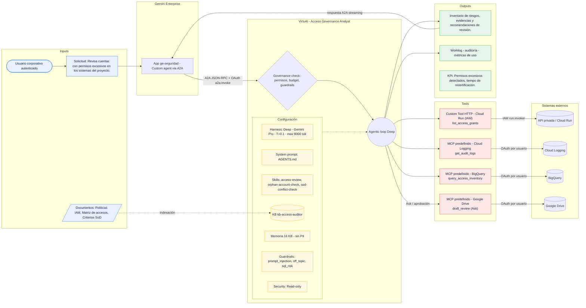
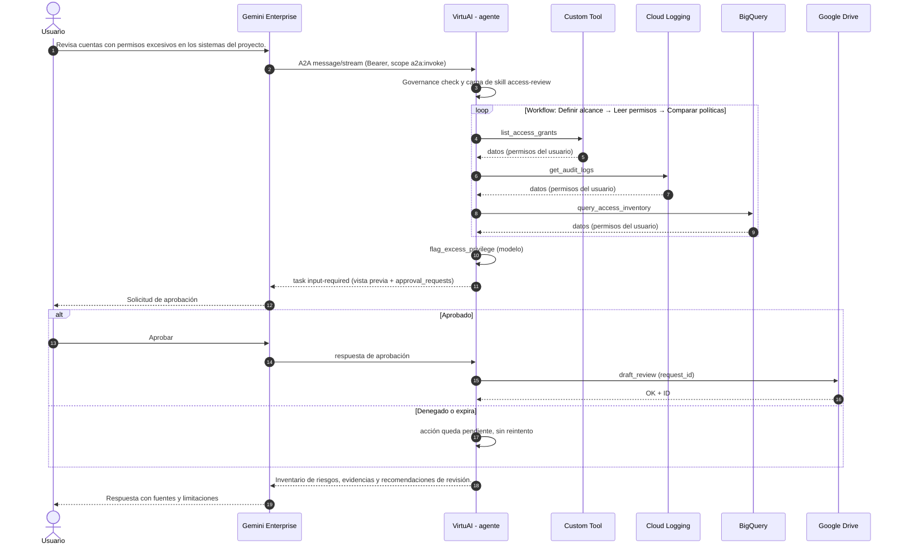
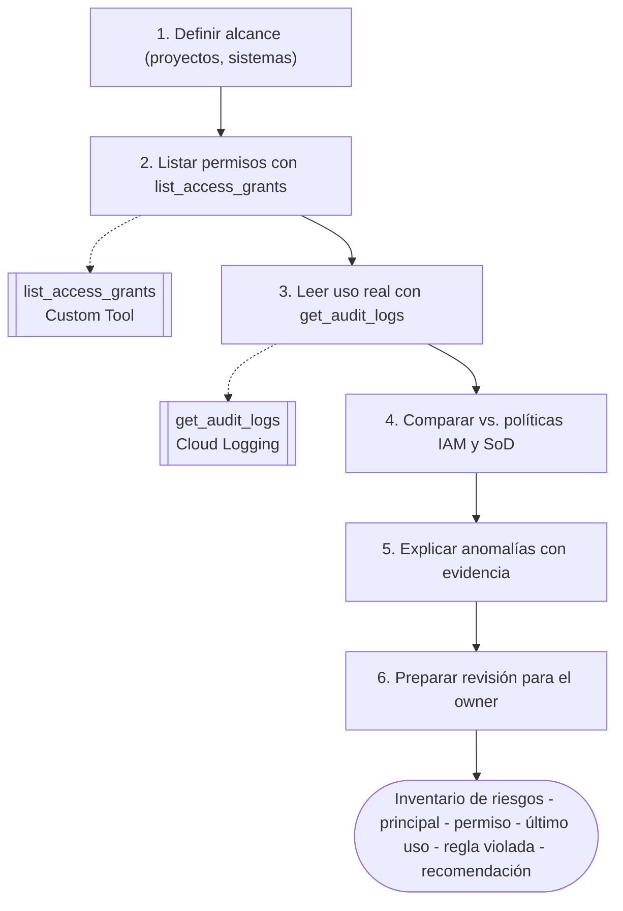

# Arquitectura - Access Governance Analyst

**Área:** Seguridad - **Harness:** Deep - **Acceso:** Lectura - **Complejidad:** 4/5 (alta) - **Impacto:** 4/5 (alto)

## 1. Arquitectura (inputs → configuración → tools → outputs)

## 2. Secuencia de una ejecución (Gemini Enterprise → A2A → VirtuAI)

## 3. Workflow de la skill principal `access-review`

## 4. Matriz de inputs, configuración, tools y outputs

| Inputs | Configuración | Tools | Outputs |
|---|---|---|---|
| Solicitud en lenguaje natural vía Gemini Enterprise Identidad del usuario (OAuth A2A) Tokens OAuth por conector Doc: Políticas IAM Doc: Matriz de accesos Doc: Criterios SoD | Harness **Deep** Modelo Gemini Pro - T=0.1 System prompt `AGENTS.md` Skills: `access-review`, `orphan-account-check`, `sod-conflict-check` KB `kb-access-auditor` Guardrails: prompt_injection, off_topic, sql_risk Memoria sin PII | `list_access_grants` (Custom Tool) `get_audit_logs` (Cloud Logging) `query_access_inventory` (BigQuery) `flag_excess_privilege` (Modelo) `draft_review` (Google Drive, Ask) | Inventario de riesgos, evidencias y recomendaciones de revisión. Worklog y auditoría en VirtuAI Sin efectos en sistemas (solo lectura) |

## 5. Capas de identidad

1. **Gemini Enterprise** — licencia + rol IAM sobre la app del área.
2. **A2A OAuth** — el usuario consiente `a2a:invoke` en VirtuAI (Authorization Code + PKCE).
3. **Conectores** — OAuth individual por MCP; IAM de servicio para Cloud Run con autorización de negocio en backend.
4. **Datos/acciones** — ACL de origen, RBAC, filas y aprobación humana.
