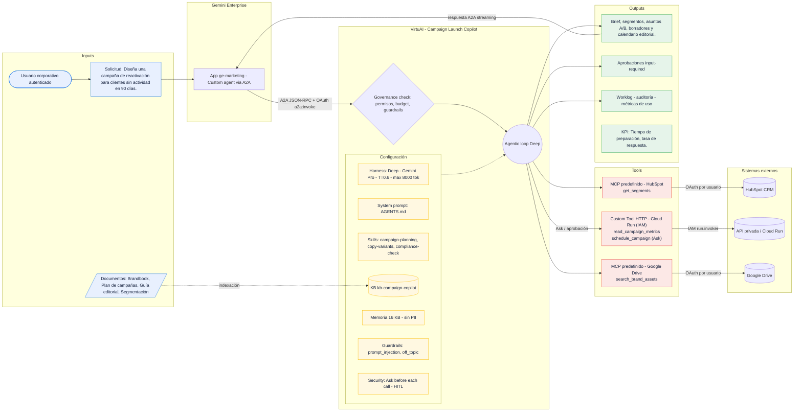
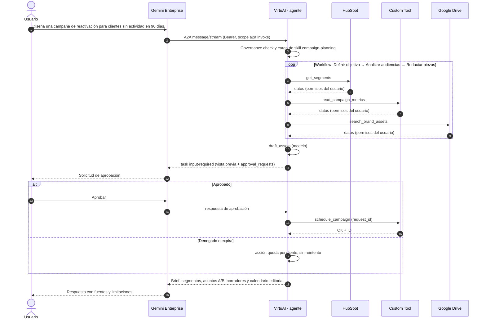
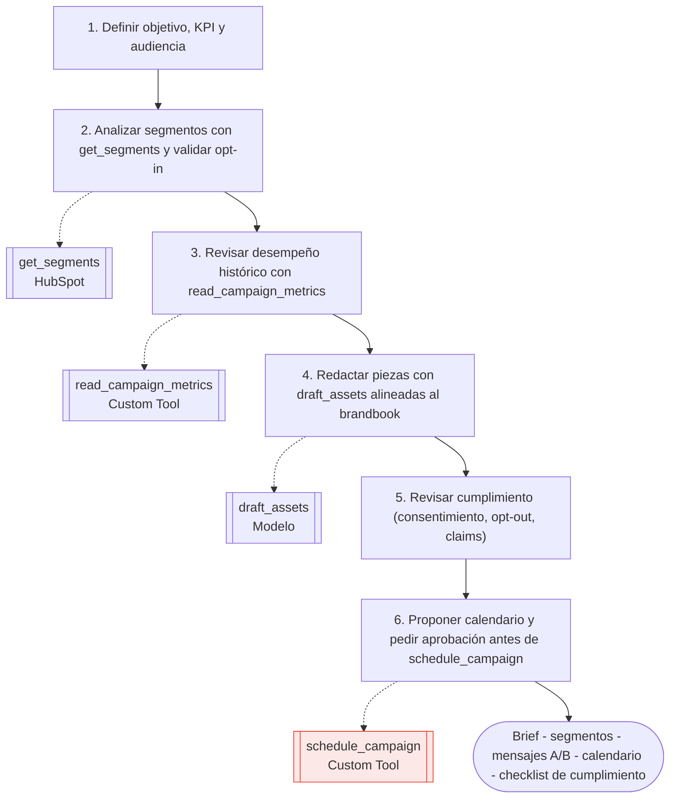

# Arquitectura - Campaign Launch Copilot

**Área:** Marketing - **Harness:** Deep - **Acceso:** Escritura con aprobación - **Complejidad:** 4/5 (alta) - **Impacto:** 3/5 (medio)

## 1. Arquitectura (inputs → configuración → tools → outputs)

## 2. Secuencia de una ejecución (Gemini Enterprise → A2A → VirtuAI)

## 3. Workflow de la skill principal `campaign-planning`

## 4. Matriz de inputs, configuración, tools y outputs

| Inputs | Configuración | Tools | Outputs |
|---|---|---|---|
| Solicitud en lenguaje natural vía Gemini Enterprise Identidad del usuario (OAuth A2A) Tokens OAuth por conector Doc: Brandbook Doc: Plan de campañas Doc: Guía editorial Doc: Segmentación | Harness **Deep** Modelo Gemini Pro - T=0.6 System prompt `AGENTS.md` Skills: `campaign-planning`, `copy-variants`, `compliance-check` KB `kb-campaign-copilot` Guardrails: prompt_injection, off_topic Memoria sin PII | `get_segments` (HubSpot) `read_campaign_metrics` (Custom Tool) `search_brand_assets` (Google Drive) `draft_assets` (Modelo) `schedule_campaign` (Custom Tool, Ask) | Brief, segmentos, asuntos A/B, borradores y calendario editorial. Worklog y auditoría en VirtuAI Acciones pendientes de aprobación |

## 5. Capas de identidad

1. **Gemini Enterprise** — licencia + rol IAM sobre la app del área.
2. **A2A OAuth** — el usuario consiente `a2a:invoke` en VirtuAI (Authorization Code + PKCE).
3. **Conectores** — OAuth individual por MCP; IAM de servicio para Cloud Run con autorización de negocio en backend.
4. **Datos/acciones** — ACL de origen, RBAC, filas y aprobación humana.
