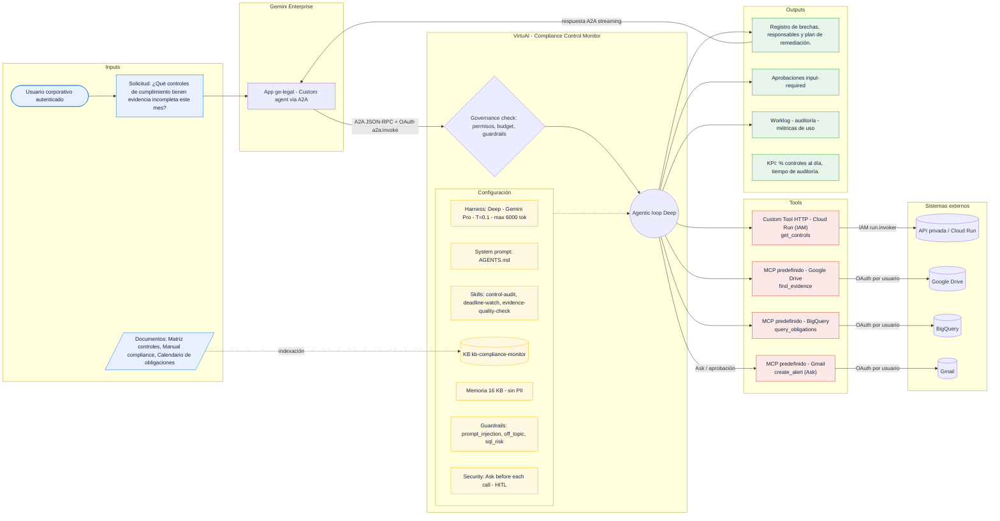
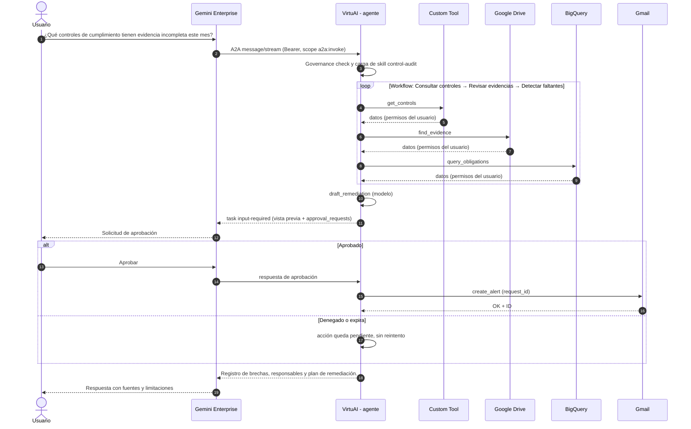
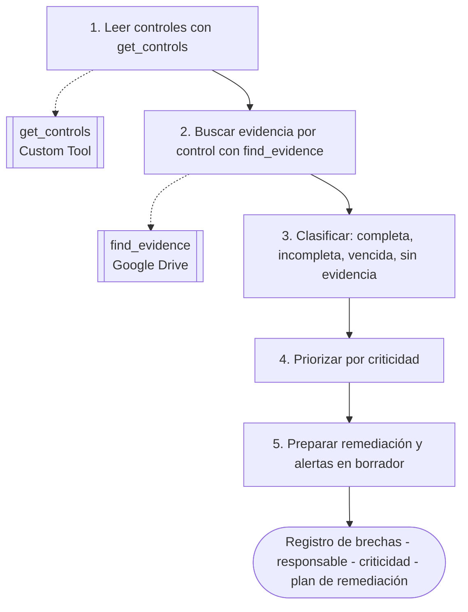

# Arquitectura - Compliance Control Monitor

**Área:** Legal - **Harness:** Deep - **Acceso:** Escritura con aprobación - **Complejidad:** 3/5 (media) - **Impacto:** 4/5 (alto)

## 1. Arquitectura (inputs → configuración → tools → outputs)

## 2. Secuencia de una ejecución (Gemini Enterprise → A2A → VirtuAI)

## 3. Workflow de la skill principal `control-audit`

## 4. Matriz de inputs, configuración, tools y outputs

| Inputs | Configuración | Tools | Outputs |
|---|---|---|---|
| Solicitud en lenguaje natural vía Gemini Enterprise Identidad del usuario (OAuth A2A) Tokens OAuth por conector Doc: Matriz controles Doc: Manual compliance Doc: Calendario de obligaciones | Harness **Deep** Modelo Gemini Pro - T=0.1 System prompt `AGENTS.md` Skills: `control-audit`, `deadline-watch`, `evidence-quality-check` KB `kb-compliance-monitor` Guardrails: prompt_injection, off_topic, sql_risk Memoria sin PII | `get_controls` (Custom Tool) `find_evidence` (Google Drive) `query_obligations` (BigQuery) `draft_remediation` (Modelo) `create_alert` (Gmail, Ask) | Registro de brechas, responsables y plan de remediación. Worklog y auditoría en VirtuAI Acciones pendientes de aprobación |

## 5. Capas de identidad

1. **Gemini Enterprise** — licencia + rol IAM sobre la app del área.
2. **A2A OAuth** — el usuario consiente `a2a:invoke` en VirtuAI (Authorization Code + PKCE).
3. **Conectores** — OAuth individual por MCP; IAM de servicio para Cloud Run con autorización de negocio en backend.
4. **Datos/acciones** — ACL de origen, RBAC, filas y aprobación humana.
