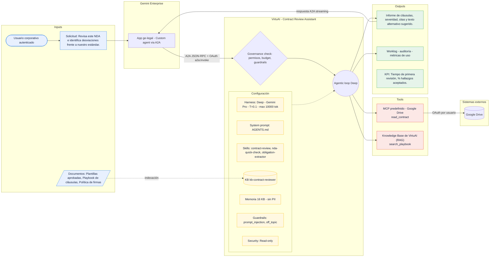
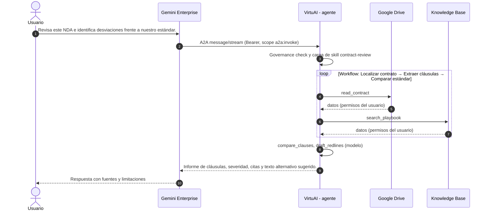
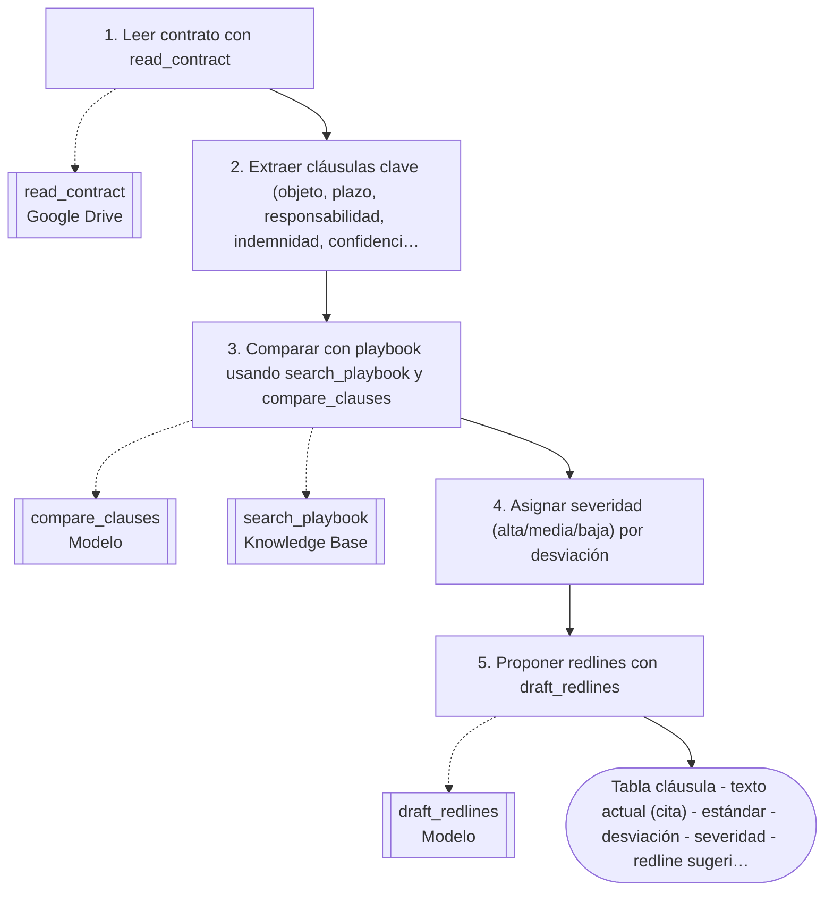

# Arquitectura - Contract Review Assistant

**Área:** Legal - **Harness:** Deep - **Acceso:** Lectura - **Complejidad:** 3/5 (media) - **Impacto:** 4/5 (alto)

## 1. Arquitectura (inputs → configuración → tools → outputs)

## 2. Secuencia de una ejecución (Gemini Enterprise → A2A → VirtuAI)

## 3. Workflow de la skill principal `contract-review`

## 4. Matriz de inputs, configuración, tools y outputs

| Inputs | Configuración | Tools | Outputs |
|---|---|---|---|
| Solicitud en lenguaje natural vía Gemini Enterprise Identidad del usuario (OAuth A2A) Tokens OAuth por conector Doc: Plantillas aprobadas Doc: Playbook de cláusulas Doc: Política de firmas | Harness **Deep** Modelo Gemini Pro - T=0.1 System prompt `AGENTS.md` Skills: `contract-review`, `nda-quick-check`, `obligation-extractor` KB `kb-contract-reviewer` Guardrails: prompt_injection, off_topic Memoria sin PII | `read_contract` (Google Drive) `compare_clauses` (Modelo) `search_playbook` (Knowledge Base) `draft_redlines` (Modelo) | Informe de cláusulas, severidad, citas y texto alternativo sugerido. Worklog y auditoría en VirtuAI Sin efectos en sistemas (solo lectura) |

## 5. Capas de identidad

1. **Gemini Enterprise** — licencia + rol IAM sobre la app del área.
2. **A2A OAuth** — el usuario consiente `a2a:invoke` en VirtuAI (Authorization Code + PKCE).
3. **Conectores** — OAuth individual por MCP; IAM de servicio para Cloud Run con autorización de negocio en backend.
4. **Datos/acciones** — ACL de origen, RBAC, filas y aprobación humana.
