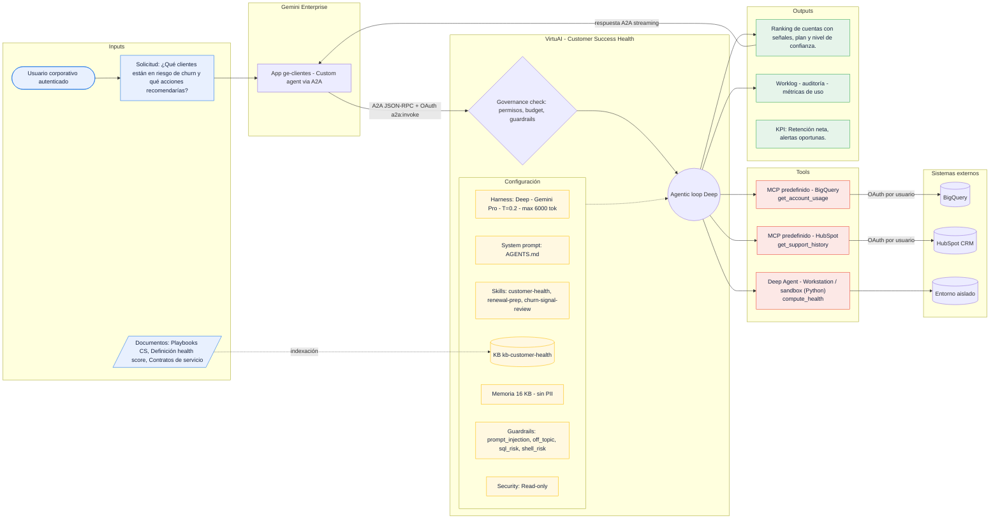
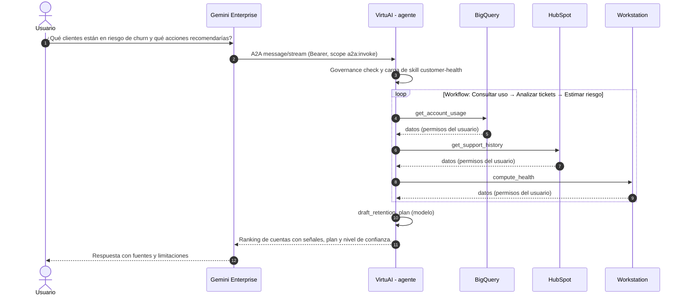
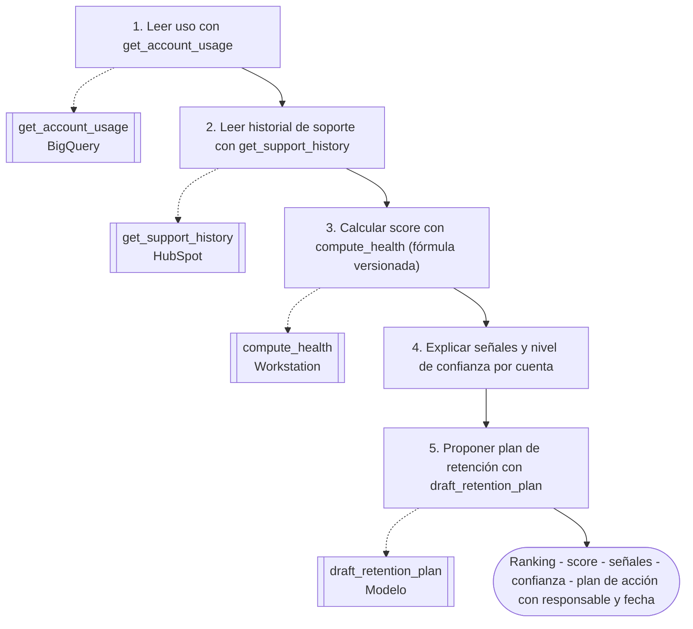

# Arquitectura - Customer Success Health

**Área:** Clientes - **Harness:** Deep - **Acceso:** Lectura - **Complejidad:** 3/5 (media) - **Impacto:** 4/5 (alto)

## 1. Arquitectura (inputs → configuración → tools → outputs)

## 2. Secuencia de una ejecución (Gemini Enterprise → A2A → VirtuAI)

## 3. Workflow de la skill principal `customer-health`

## 4. Matriz de inputs, configuración, tools y outputs

| Inputs | Configuración | Tools | Outputs |
|---|---|---|---|
| Solicitud en lenguaje natural vía Gemini Enterprise Identidad del usuario (OAuth A2A) Tokens OAuth por conector Doc: Playbooks CS Doc: Definición health score Doc: Contratos de servicio | Harness **Deep** Modelo Gemini Pro - T=0.2 System prompt `AGENTS.md` Skills: `customer-health`, `renewal-prep`, `churn-signal-review` KB `kb-customer-health` Guardrails: prompt_injection, off_topic, sql_risk, shell_risk Memoria sin PII | `get_account_usage` (BigQuery) `get_support_history` (HubSpot) `compute_health` (Workstation, Ask) `draft_retention_plan` (Modelo) | Ranking de cuentas con señales, plan y nivel de confianza. Worklog y auditoría en VirtuAI Sin efectos en sistemas (solo lectura) |

## 5. Capas de identidad

1. **Gemini Enterprise** — licencia + rol IAM sobre la app del área.
2. **A2A OAuth** — el usuario consiente `a2a:invoke` en VirtuAI (Authorization Code + PKCE).
3. **Conectores** — OAuth individual por MCP; IAM de servicio para Cloud Run con autorización de negocio en backend.
4. **Datos/acciones** — ACL de origen, RBAC, filas y aprobación humana.
