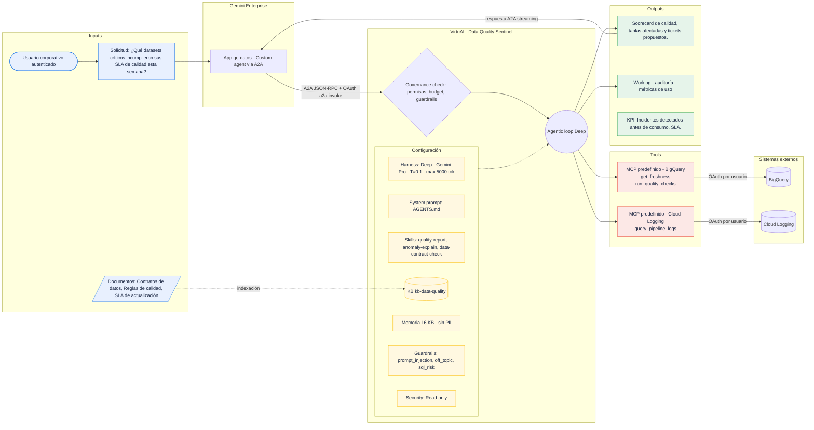
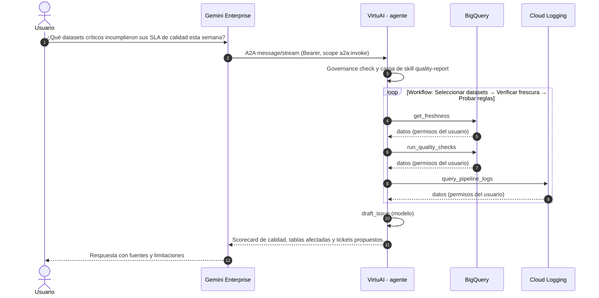
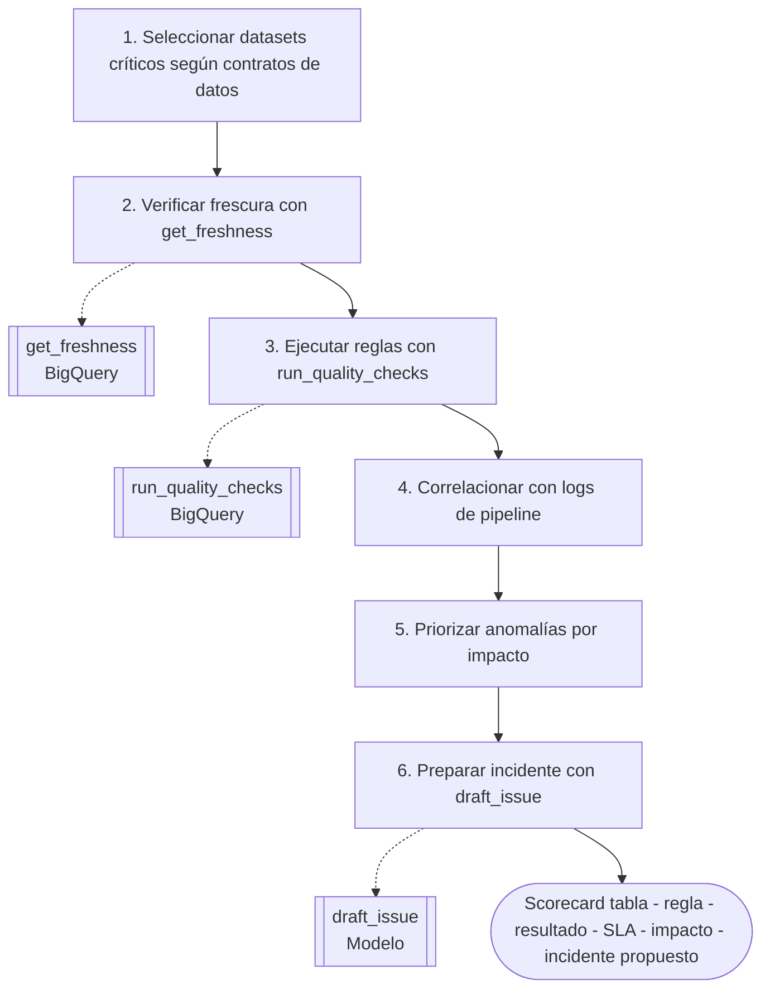

# Arquitectura - Data Quality Sentinel

**Área:** Datos - **Harness:** Deep - **Acceso:** Lectura - **Complejidad:** 3/5 (media) - **Impacto:** 3/5 (medio)

## 1. Arquitectura (inputs → configuración → tools → outputs)

## 2. Secuencia de una ejecución (Gemini Enterprise → A2A → VirtuAI)

## 3. Workflow de la skill principal `quality-report`

## 4. Matriz de inputs, configuración, tools y outputs

| Inputs | Configuración | Tools | Outputs |
|---|---|---|---|
| Solicitud en lenguaje natural vía Gemini Enterprise Identidad del usuario (OAuth A2A) Tokens OAuth por conector Doc: Contratos de datos Doc: Reglas de calidad Doc: SLA de actualización | Harness **Deep** Modelo Gemini Pro - T=0.1 System prompt `AGENTS.md` Skills: `quality-report`, `anomaly-explain`, `data-contract-check` KB `kb-data-quality` Guardrails: prompt_injection, off_topic, sql_risk Memoria sin PII | `get_freshness` (BigQuery) `run_quality_checks` (BigQuery) `query_pipeline_logs` (Cloud Logging) `draft_issue` (Modelo) | Scorecard de calidad, tablas afectadas y tickets propuestos. Worklog y auditoría en VirtuAI Sin efectos en sistemas (solo lectura) |

## 5. Capas de identidad

1. **Gemini Enterprise** — licencia + rol IAM sobre la app del área.
2. **A2A OAuth** — el usuario consiente `a2a:invoke` en VirtuAI (Authorization Code + PKCE).
3. **Conectores** — OAuth individual por MCP; IAM de servicio para Cloud Run con autorización de negocio en backend.
4. **Datos/acciones** — ACL de origen, RBAC, filas y aprobación humana.
