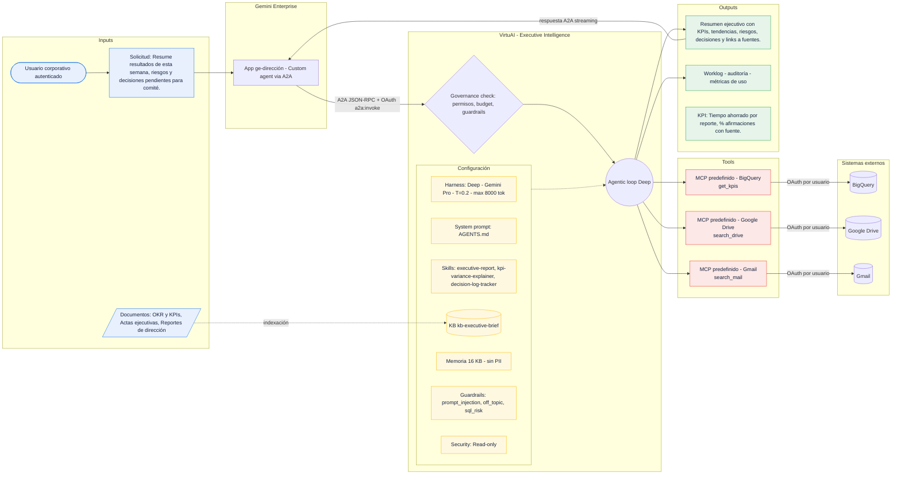
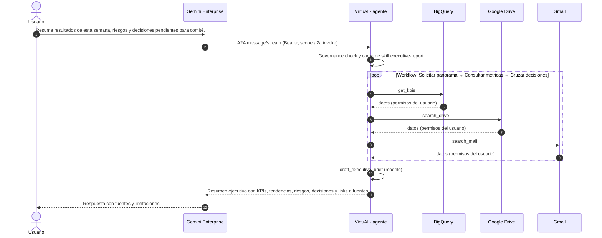
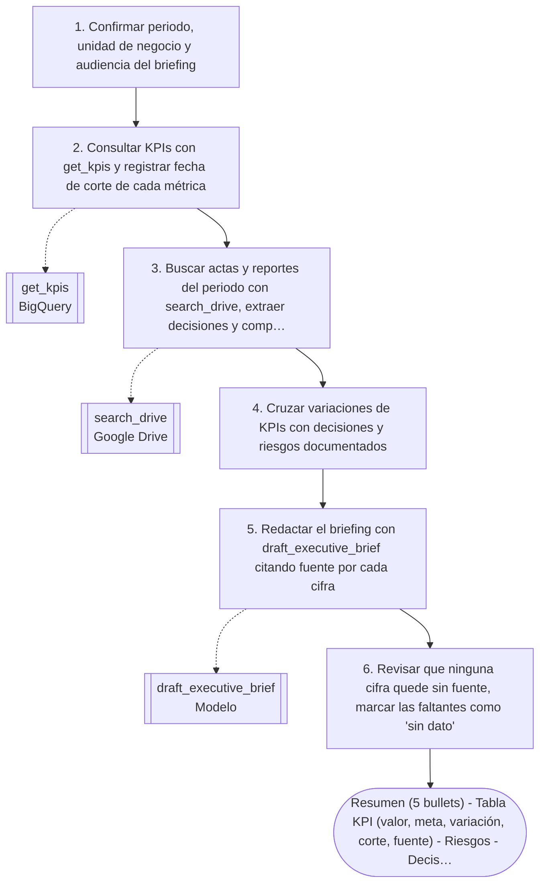

# Arquitectura - Executive Intelligence

**Área:** Dirección - **Harness:** Deep - **Acceso:** Lectura - **Complejidad:** 2/5 (baja) - **Impacto:** 4/5 (alto)

## 1. Arquitectura (inputs → configuración → tools → outputs)

## 2. Secuencia de una ejecución (Gemini Enterprise → A2A → VirtuAI)

## 3. Workflow de la skill principal `executive-report`

## 4. Matriz de inputs, configuración, tools y outputs

| Inputs | Configuración | Tools | Outputs |
|---|---|---|---|
| Solicitud en lenguaje natural vía Gemini Enterprise Identidad del usuario (OAuth A2A) Tokens OAuth por conector Doc: OKR y KPIs Doc: Actas ejecutivas Doc: Reportes de dirección | Harness **Deep** Modelo Gemini Pro - T=0.2 System prompt `AGENTS.md` Skills: `executive-report`, `kpi-variance-explainer`, `decision-log-tracker` KB `kb-executive-brief` Guardrails: prompt_injection, off_topic, sql_risk Memoria sin PII | `get_kpis` (BigQuery) `search_drive` (Google Drive) `search_mail` (Gmail) `draft_executive_brief` (Modelo) | Resumen ejecutivo con KPIs, tendencias, riesgos, decisiones y links a fuentes. Worklog y auditoría en VirtuAI Sin efectos en sistemas (solo lectura) |

## 5. Capas de identidad

1. **Gemini Enterprise** — licencia + rol IAM sobre la app del área.
2. **A2A OAuth** — el usuario consiente `a2a:invoke` en VirtuAI (Authorization Code + PKCE).
3. **Conectores** — OAuth individual por MCP; IAM de servicio para Cloud Run con autorización de negocio en backend.
4. **Datos/acciones** — ACL de origen, RBAC, filas y aprobación humana.
