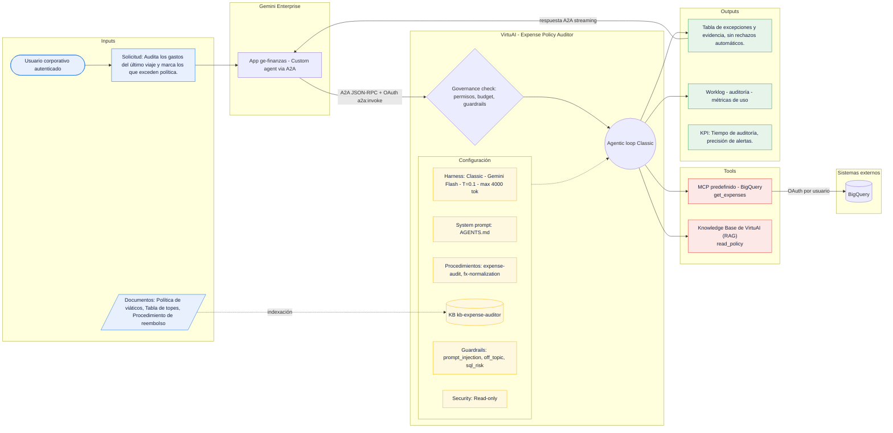
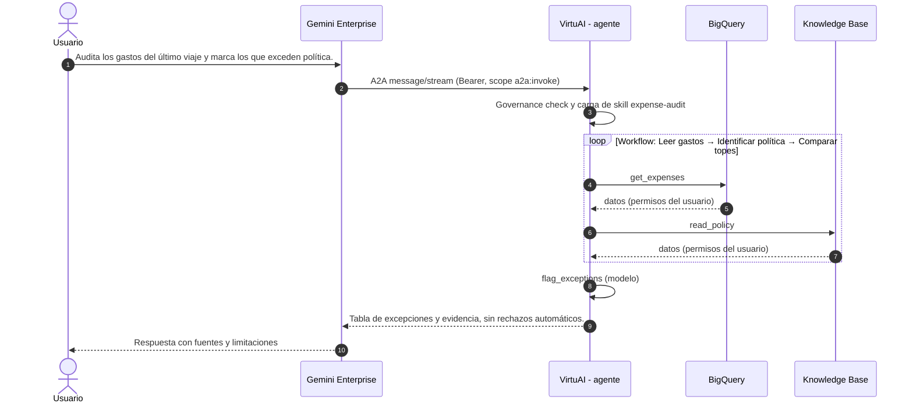
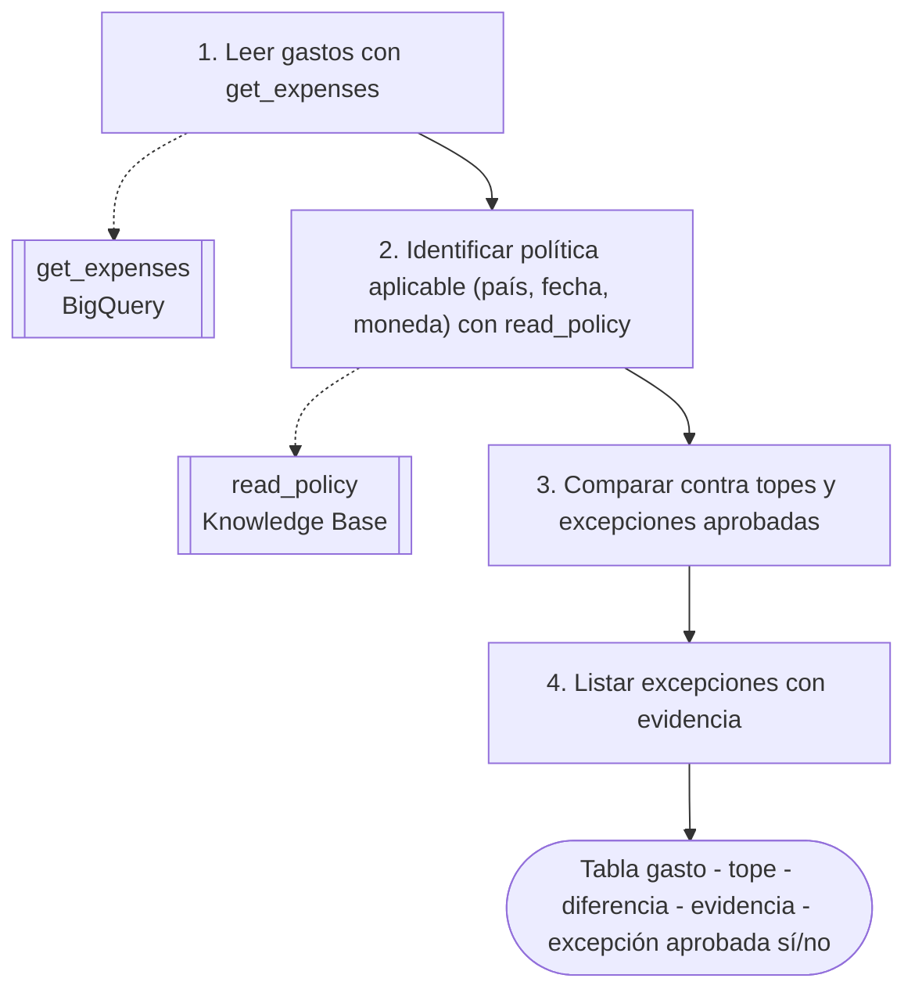

# Arquitectura - Expense Policy Auditor

**Área:** Finanzas - **Harness:** Classic - **Acceso:** Lectura - **Complejidad:** 2/5 (baja) - **Impacto:** 3/5 (medio)

## 1. Arquitectura (inputs → configuración → tools → outputs)

## 2. Secuencia de una ejecución (Gemini Enterprise → A2A → VirtuAI)

## 3. Workflow de la skill principal `expense-audit`

## 4. Matriz de inputs, configuración, tools y outputs

| Inputs | Configuración | Tools | Outputs |
|---|---|---|---|
| Solicitud en lenguaje natural vía Gemini Enterprise Identidad del usuario (OAuth A2A) Tokens OAuth por conector Doc: Política de viáticos Doc: Tabla de topes Doc: Procedimiento de reembolso | Harness **Classic** Modelo Gemini Flash - T=0.1 System prompt `AGENTS.md` Procedimientos: `expense-audit`, `fx-normalization` KB `kb-expense-auditor` Guardrails: prompt_injection, off_topic, sql_risk | `get_expenses` (BigQuery) `read_policy` (Knowledge Base) `flag_exceptions` (Modelo) | Tabla de excepciones y evidencia, sin rechazos automáticos. Worklog y auditoría en VirtuAI Sin efectos en sistemas (solo lectura) |

## 5. Capas de identidad

1. **Gemini Enterprise** — licencia + rol IAM sobre la app del área.
2. **A2A OAuth** — el usuario consiente `a2a:invoke` en VirtuAI (Authorization Code + PKCE).
3. **Conectores** — OAuth individual por MCP; IAM de servicio para Cloud Run con autorización de negocio en backend.
4. **Datos/acciones** — ACL de origen, RBAC, filas y aprobación humana.
