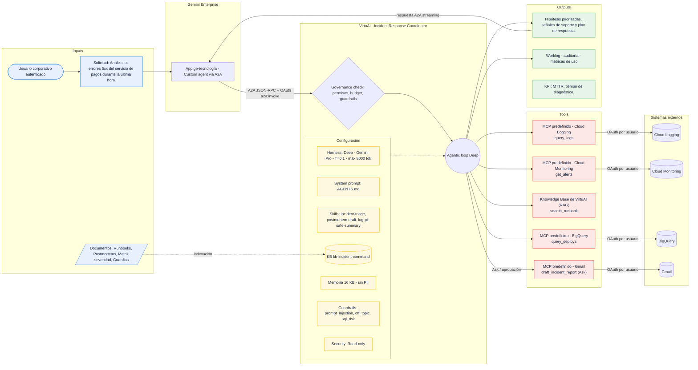
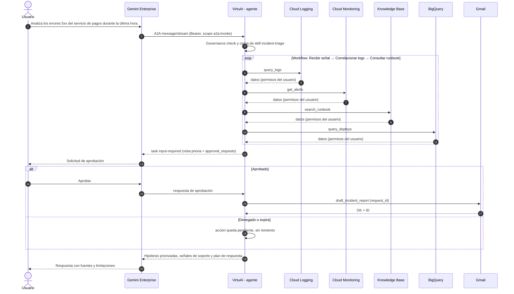
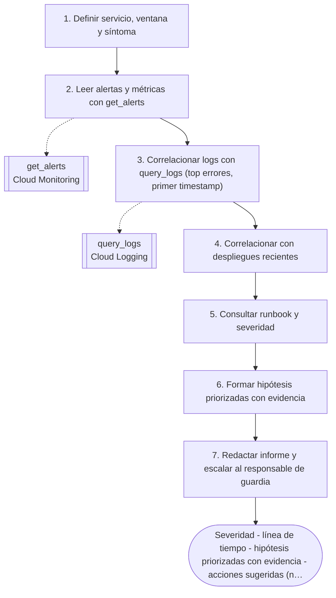

# Arquitectura - Incident Response Coordinator

**Área:** Tecnología - **Harness:** Deep - **Acceso:** Lectura - **Complejidad:** 4/5 (alta) - **Impacto:** 4/5 (alto)

## 1. Arquitectura (inputs → configuración → tools → outputs)

## 2. Secuencia de una ejecución (Gemini Enterprise → A2A → VirtuAI)

## 3. Workflow de la skill principal `incident-triage`

## 4. Matriz de inputs, configuración, tools y outputs

| Inputs | Configuración | Tools | Outputs |
|---|---|---|---|
| Solicitud en lenguaje natural vía Gemini Enterprise Identidad del usuario (OAuth A2A) Tokens OAuth por conector Doc: Runbooks Doc: Postmortems Doc: Matriz severidad Doc: Guardias | Harness **Deep** Modelo Gemini Pro - T=0.1 System prompt `AGENTS.md` Skills: `incident-triage`, `postmortem-draft`, `log-pii-safe-summary` KB `kb-incident-command` Guardrails: prompt_injection, off_topic, sql_risk Memoria sin PII | `query_logs` (Cloud Logging) `get_alerts` (Cloud Monitoring) `search_runbook` (Knowledge Base) `query_deploys` (BigQuery) `draft_incident_report` (Gmail, Ask) | Hipótesis priorizadas, señales de soporte y plan de respuesta. Worklog y auditoría en VirtuAI Sin efectos en sistemas (solo lectura) |

## 5. Capas de identidad

1. **Gemini Enterprise** — licencia + rol IAM sobre la app del área.
2. **A2A OAuth** — el usuario consiente `a2a:invoke` en VirtuAI (Authorization Code + PKCE).
3. **Conectores** — OAuth individual por MCP; IAM de servicio para Cloud Run con autorización de negocio en backend.
4. **Datos/acciones** — ACL de origen, RBAC, filas y aprobación humana.
