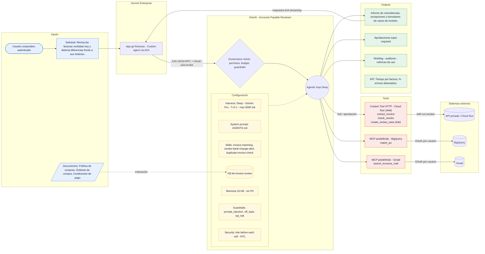
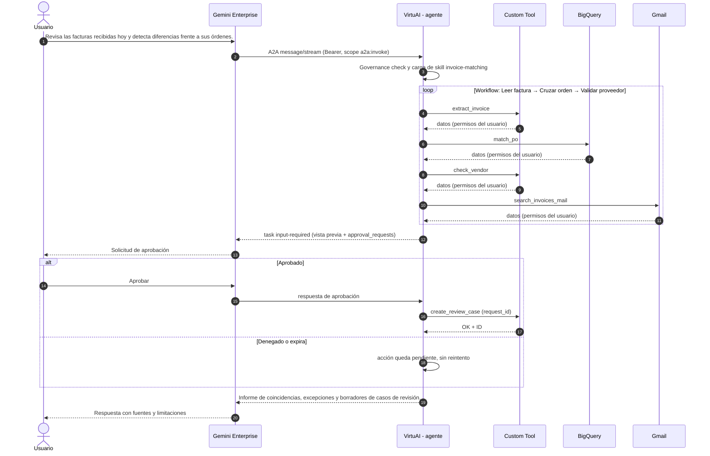
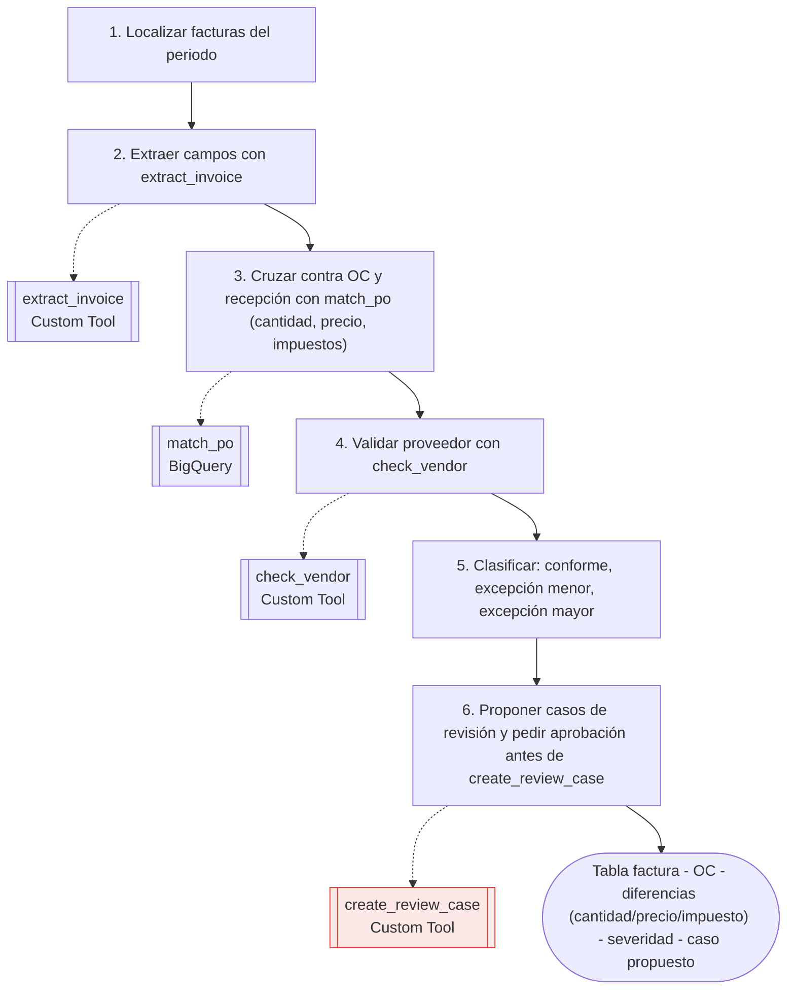

# Arquitectura - Accounts Payable Reviewer

**Área:** Finanzas - **Harness:** Deep - **Acceso:** Escritura con aprobación - **Complejidad:** 5/5 (muy alta) - **Impacto:** 5/5 (muy alto)

## 1. Arquitectura (inputs → configuración → tools → outputs)

## 2. Secuencia de una ejecución (Gemini Enterprise → A2A → VirtuAI)

## 3. Workflow de la skill principal `invoice-matching`

## 4. Matriz de inputs, configuración, tools y outputs

| Inputs | Configuración | Tools | Outputs |
|---|---|---|---|
| Solicitud en lenguaje natural vía Gemini Enterprise Identidad del usuario (OAuth A2A) Tokens OAuth por conector Doc: Política de compras Doc: Órdenes de compra Doc: Condiciones de pago | Harness **Deep** Modelo Gemini Pro - T=0.1 System prompt `AGENTS.md` Skills: `invoice-matching`, `vendor-bank-change-alert`, `duplicate-invoice-check` KB `kb-invoice-review` Guardrails: prompt_injection, off_topic, sql_risk Memoria sin PII | `extract_invoice` (Custom Tool) `match_po` (BigQuery) `check_vendor` (Custom Tool) `search_invoices_mail` (Gmail) `create_review_case` (Custom Tool, Ask) | Informe de coincidencias, excepciones y borradores de casos de revisión. Worklog y auditoría en VirtuAI Acciones pendientes de aprobación |

## 5. Capas de identidad

1. **Gemini Enterprise** — licencia + rol IAM sobre la app del área.
2. **A2A OAuth** — el usuario consiente `a2a:invoke` en VirtuAI (Authorization Code + PKCE).
3. **Conectores** — OAuth individual por MCP; IAM de servicio para Cloud Run con autorización de negocio en backend.
4. **Datos/acciones** — ACL de origen, RBAC, filas y aprobación humana.
