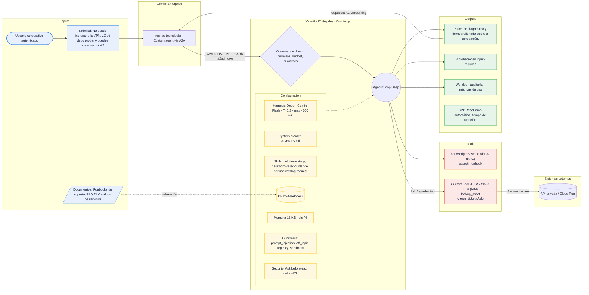
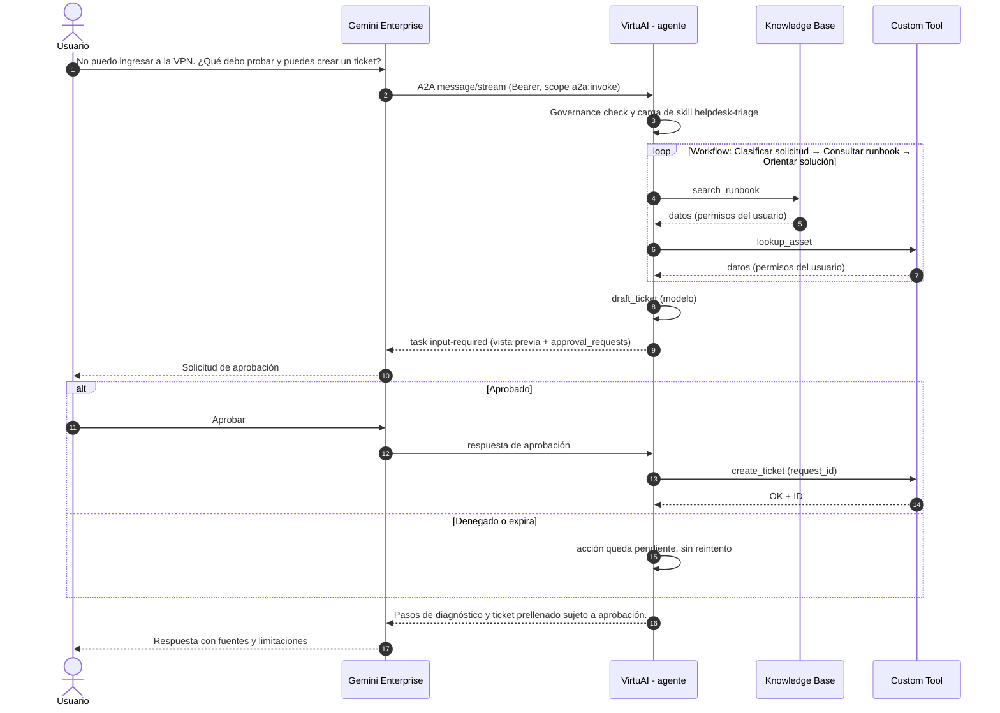
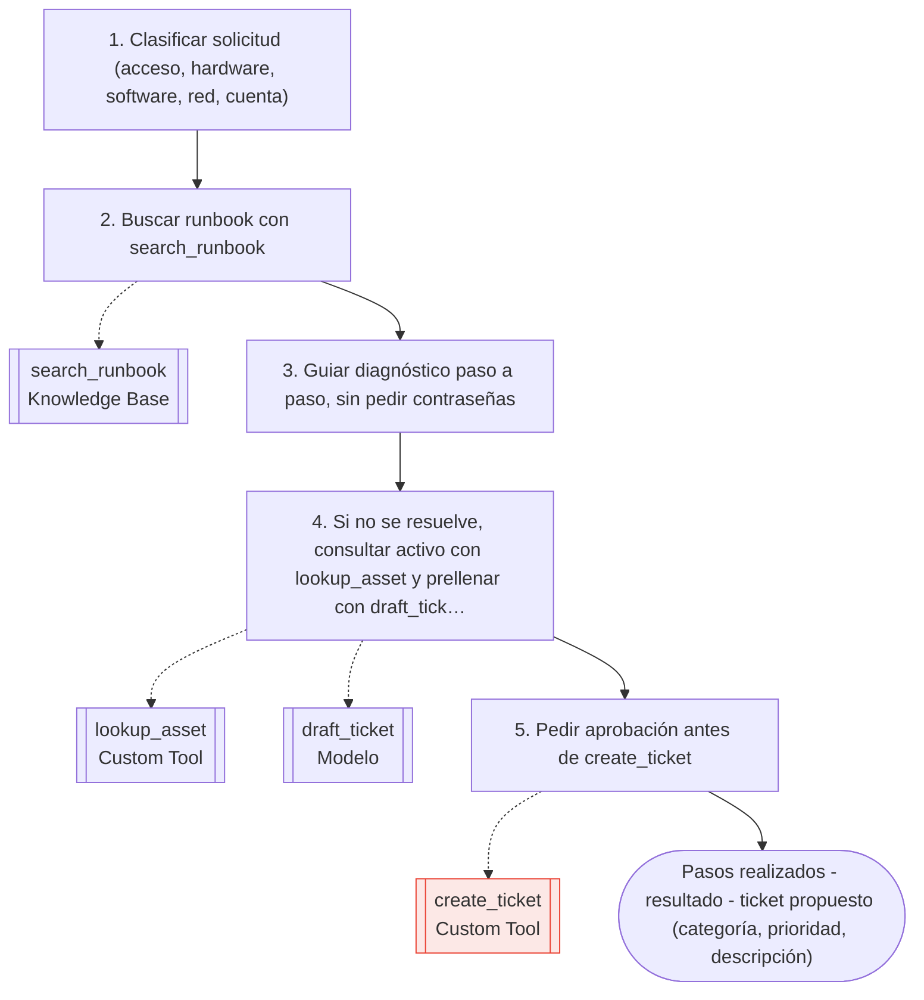

# Arquitectura - IT Helpdesk Concierge

**Área:** Tecnología - **Harness:** Deep - **Acceso:** Escritura con aprobación - **Complejidad:** 3/5 (media) - **Impacto:** 5/5 (muy alto)

## 1. Arquitectura (inputs → configuración → tools → outputs)

## 2. Secuencia de una ejecución (Gemini Enterprise → A2A → VirtuAI)

## 3. Workflow de la skill principal `helpdesk-triage`

## 4. Matriz de inputs, configuración, tools y outputs

| Inputs | Configuración | Tools | Outputs |
|---|---|---|---|
| Solicitud en lenguaje natural vía Gemini Enterprise Identidad del usuario (OAuth A2A) Tokens OAuth por conector Doc: Runbooks de soporte Doc: FAQ TI Doc: Catálogo de servicios | Harness **Deep** Modelo Gemini Flash - T=0.2 System prompt `AGENTS.md` Skills: `helpdesk-triage`, `password-reset-guidance`, `service-catalog-request` KB `kb-it-helpdesk` Guardrails: prompt_injection, off_topic, urgency, sentiment Memoria sin PII | `search_runbook` (Knowledge Base) `lookup_asset` (Custom Tool) `draft_ticket` (Modelo) `create_ticket` (Custom Tool, Ask) | Pasos de diagnóstico y ticket prellenado sujeto a aprobación. Worklog y auditoría en VirtuAI Acciones pendientes de aprobación |

## 5. Capas de identidad

1. **Gemini Enterprise** — licencia + rol IAM sobre la app del área.
2. **A2A OAuth** — el usuario consiente `a2a:invoke` en VirtuAI (Authorization Code + PKCE).
3. **Conectores** — OAuth individual por MCP; IAM de servicio para Cloud Run con autorización de negocio en backend.
4. **Datos/acciones** — ACL de origen, RBAC, filas y aprobación humana.
