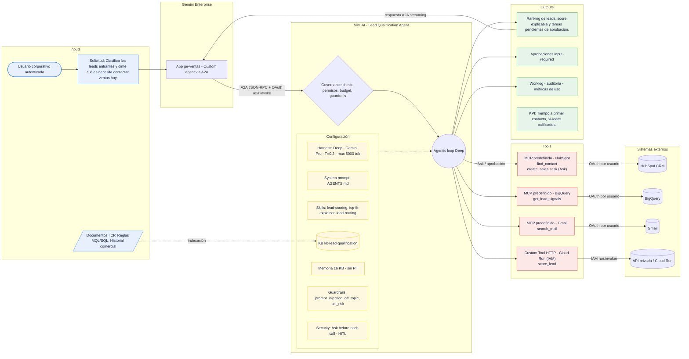
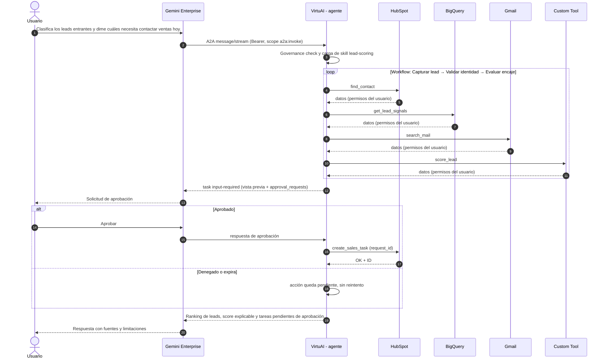
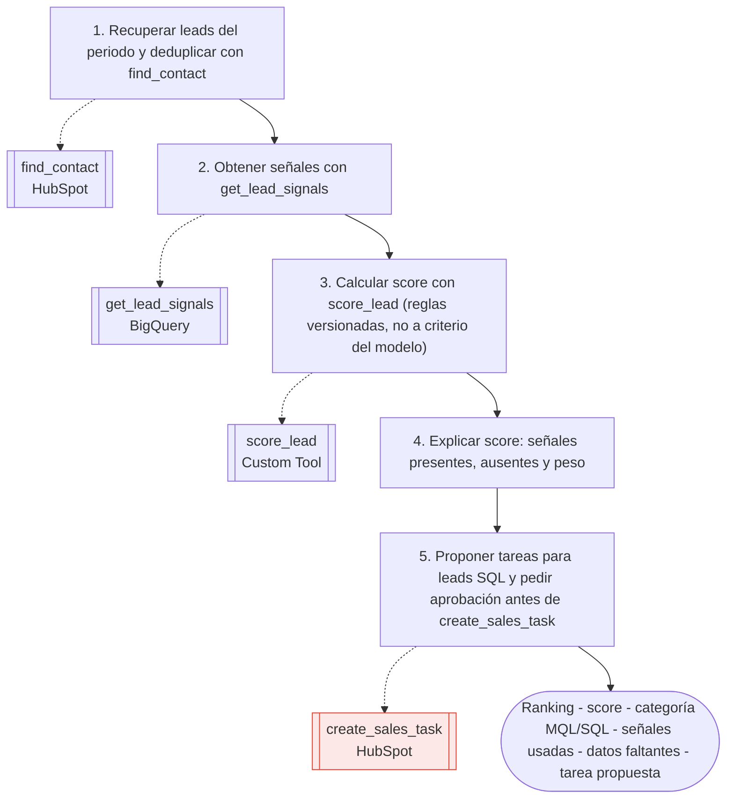

# Arquitectura - Lead Qualification Agent

**Área:** Ventas - **Harness:** Deep - **Acceso:** Escritura con aprobación - **Complejidad:** 3/5 (media) - **Impacto:** 4/5 (alto)

## 1. Arquitectura (inputs → configuración → tools → outputs)

## 2. Secuencia de una ejecución (Gemini Enterprise → A2A → VirtuAI)

## 3. Workflow de la skill principal `lead-scoring`

## 4. Matriz de inputs, configuración, tools y outputs

| Inputs | Configuración | Tools | Outputs |
|---|---|---|---|
| Solicitud en lenguaje natural vía Gemini Enterprise Identidad del usuario (OAuth A2A) Tokens OAuth por conector Doc: ICP Doc: Reglas MQL/SQL Doc: Historial comercial | Harness **Deep** Modelo Gemini Pro - T=0.2 System prompt `AGENTS.md` Skills: `lead-scoring`, `icp-fit-explainer`, `lead-routing` KB `kb-lead-qualification` Guardrails: prompt_injection, off_topic, sql_risk Memoria sin PII | `find_contact` (HubSpot) `get_lead_signals` (BigQuery) `search_mail` (Gmail) `score_lead` (Custom Tool) `create_sales_task` (HubSpot, Ask) | Ranking de leads, score explicable y tareas pendientes de aprobación. Worklog y auditoría en VirtuAI Acciones pendientes de aprobación |

## 5. Capas de identidad

1. **Gemini Enterprise** — licencia + rol IAM sobre la app del área.
2. **A2A OAuth** — el usuario consiente `a2a:invoke` en VirtuAI (Authorization Code + PKCE).
3. **Conectores** — OAuth individual por MCP; IAM de servicio para Cloud Run con autorización de negocio en backend.
4. **Datos/acciones** — ACL de origen, RBAC, filas y aprobación humana.
