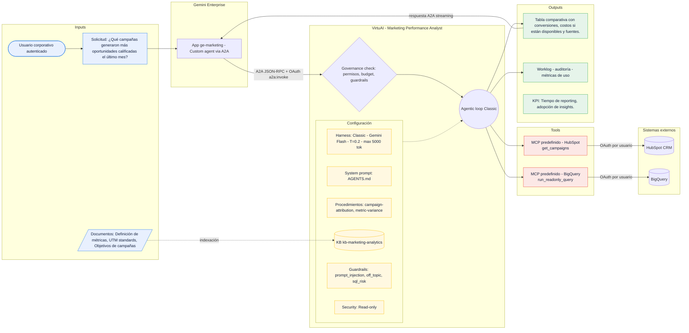
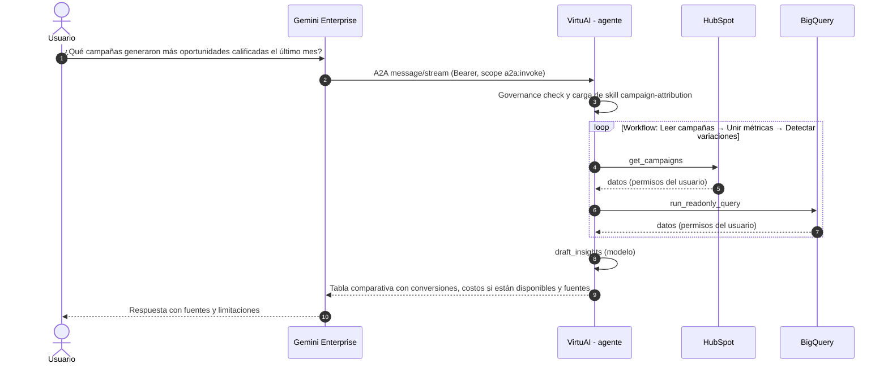
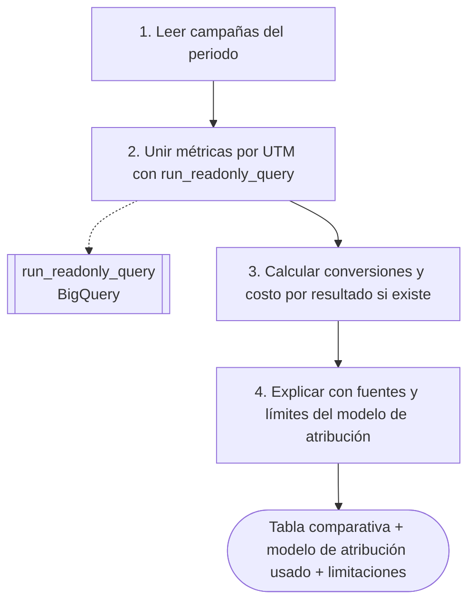

# Arquitectura - Marketing Performance Analyst

**Área:** Marketing - **Harness:** Classic - **Acceso:** Lectura - **Complejidad:** 2/5 (baja) - **Impacto:** 3/5 (medio)

## 1. Arquitectura (inputs → configuración → tools → outputs)

## 2. Secuencia de una ejecución (Gemini Enterprise → A2A → VirtuAI)

## 3. Workflow de la skill principal `campaign-attribution`

## 4. Matriz de inputs, configuración, tools y outputs

| Inputs | Configuración | Tools | Outputs |
|---|---|---|---|
| Solicitud en lenguaje natural vía Gemini Enterprise Identidad del usuario (OAuth A2A) Tokens OAuth por conector Doc: Definición de métricas Doc: UTM standards Doc: Objetivos de campañas | Harness **Classic** Modelo Gemini Flash - T=0.2 System prompt `AGENTS.md` Procedimientos: `campaign-attribution`, `metric-variance` KB `kb-marketing-analytics` Guardrails: prompt_injection, off_topic, sql_risk | `get_campaigns` (HubSpot) `run_readonly_query` (BigQuery) `draft_insights` (Modelo) | Tabla comparativa con conversiones, costos si están disponibles y fuentes. Worklog y auditoría en VirtuAI Sin efectos en sistemas (solo lectura) |

## 5. Capas de identidad

1. **Gemini Enterprise** — licencia + rol IAM sobre la app del área.
2. **A2A OAuth** — el usuario consiente `a2a:invoke` en VirtuAI (Authorization Code + PKCE).
3. **Conectores** — OAuth individual por MCP; IAM de servicio para Cloud Run con autorización de negocio en backend.
4. **Datos/acciones** — ACL de origen, RBAC, filas y aprobación humana.
