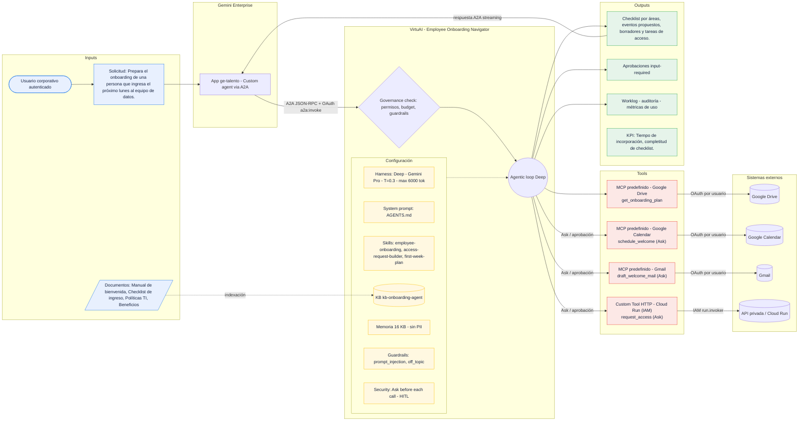
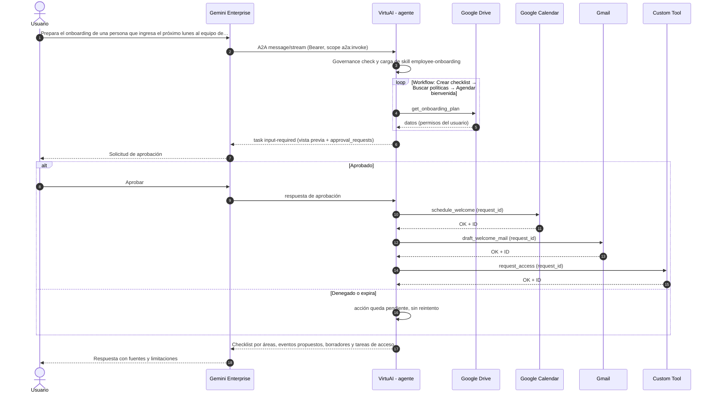
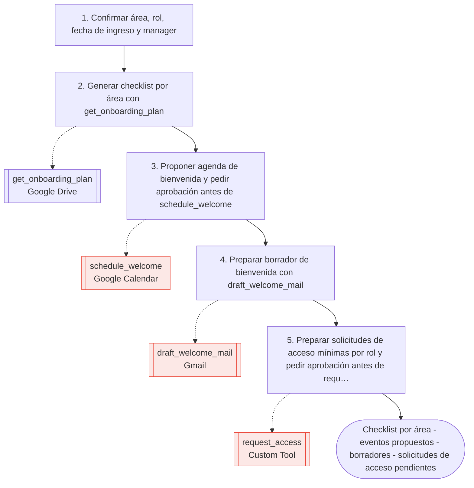

# Arquitectura - Employee Onboarding Navigator

**Área:** Talento - **Harness:** Deep - **Acceso:** Escritura con aprobación - **Complejidad:** 4/5 (alta) - **Impacto:** 3/5 (medio)

## 1. Arquitectura (inputs → configuración → tools → outputs)

## 2. Secuencia de una ejecución (Gemini Enterprise → A2A → VirtuAI)

## 3. Workflow de la skill principal `employee-onboarding`

## 4. Matriz de inputs, configuración, tools y outputs

| Inputs | Configuración | Tools | Outputs |
|---|---|---|---|
| Solicitud en lenguaje natural vía Gemini Enterprise Identidad del usuario (OAuth A2A) Tokens OAuth por conector Doc: Manual de bienvenida Doc: Checklist de ingreso Doc: Políticas TI Doc: Beneficios | Harness **Deep** Modelo Gemini Pro - T=0.3 System prompt `AGENTS.md` Skills: `employee-onboarding`, `access-request-builder`, `first-week-plan` KB `kb-onboarding-agent` Guardrails: prompt_injection, off_topic Memoria sin PII | `get_onboarding_plan` (Google Drive) `schedule_welcome` (Google Calendar, Ask) `draft_welcome_mail` (Gmail, Ask) `request_access` (Custom Tool, Ask) | Checklist por áreas, eventos propuestos, borradores y tareas de acceso. Worklog y auditoría en VirtuAI Acciones pendientes de aprobación |

## 5. Capas de identidad

1. **Gemini Enterprise** — licencia + rol IAM sobre la app del área.
2. **A2A OAuth** — el usuario consiente `a2a:invoke` en VirtuAI (Authorization Code + PKCE).
3. **Conectores** — OAuth individual por MCP; IAM de servicio para Cloud Run con autorización de negocio en backend.
4. **Datos/acciones** — ACL de origen, RBAC, filas y aprobación humana.
