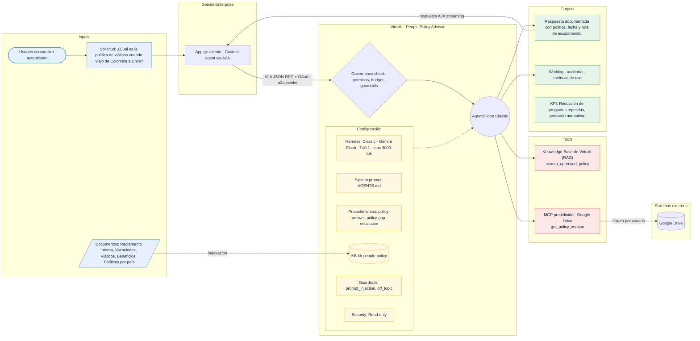
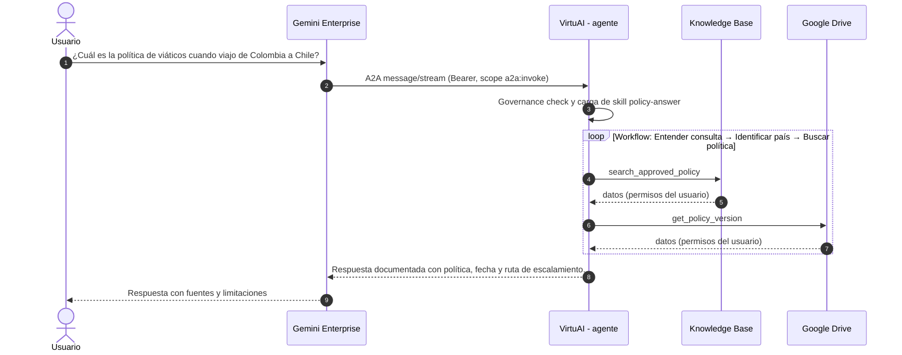
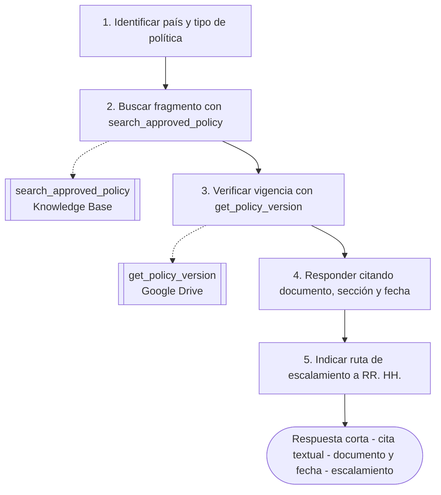

# Arquitectura - People Policy Advisor

**Área:** Talento - **Harness:** Classic - **Acceso:** Lectura - **Complejidad:** 1/5 (muy baja) - **Impacto:** 4/5 (alto)

## 1. Arquitectura (inputs → configuración → tools → outputs)

## 2. Secuencia de una ejecución (Gemini Enterprise → A2A → VirtuAI)

## 3. Workflow de la skill principal `policy-answer`

## 4. Matriz de inputs, configuración, tools y outputs

| Inputs | Configuración | Tools | Outputs |
|---|---|---|---|
| Solicitud en lenguaje natural vía Gemini Enterprise Identidad del usuario (OAuth A2A) Tokens OAuth por conector Doc: Reglamento interno Doc: Vacaciones Doc: Viáticos Doc: Beneficios Doc: Políticas por país | Harness **Classic** Modelo Gemini Flash - T=0.1 System prompt `AGENTS.md` Procedimientos: `policy-answer`, `policy-gap-escalation` KB `kb-people-policy` Guardrails: prompt_injection, off_topic | `search_approved_policy` (Knowledge Base) `get_policy_version` (Google Drive) | Respuesta documentada con política, fecha y ruta de escalamiento. Worklog y auditoría en VirtuAI Sin efectos en sistemas (solo lectura) |

## 5. Capas de identidad

1. **Gemini Enterprise** — licencia + rol IAM sobre la app del área.
2. **A2A OAuth** — el usuario consiente `a2a:invoke` en VirtuAI (Authorization Code + PKCE).
3. **Conectores** — OAuth individual por MCP; IAM de servicio para Cloud Run con autorización de negocio en backend.
4. **Datos/acciones** — ACL de origen, RBAC, filas y aprobación humana.
