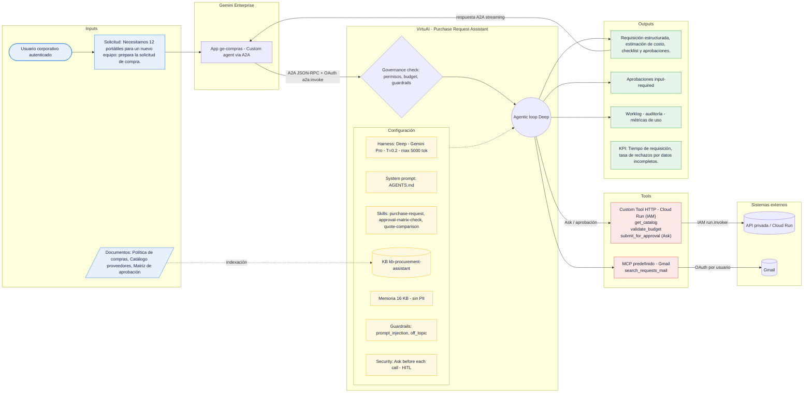
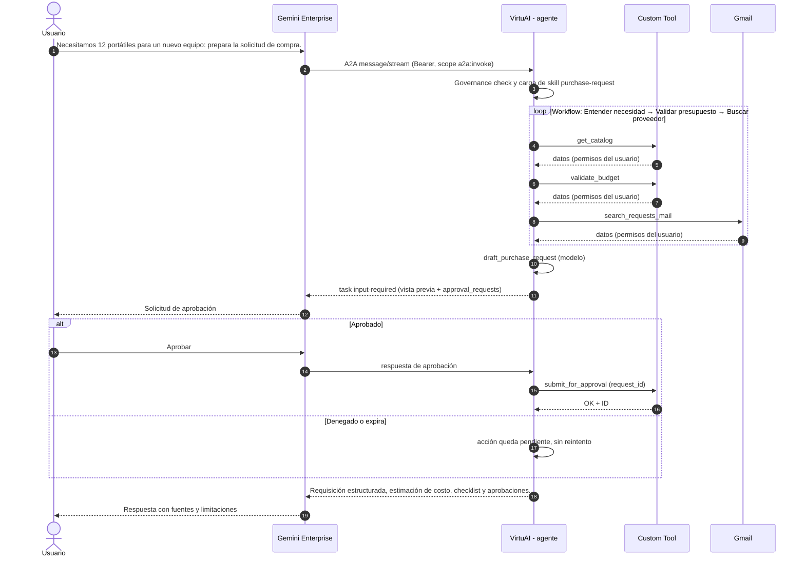
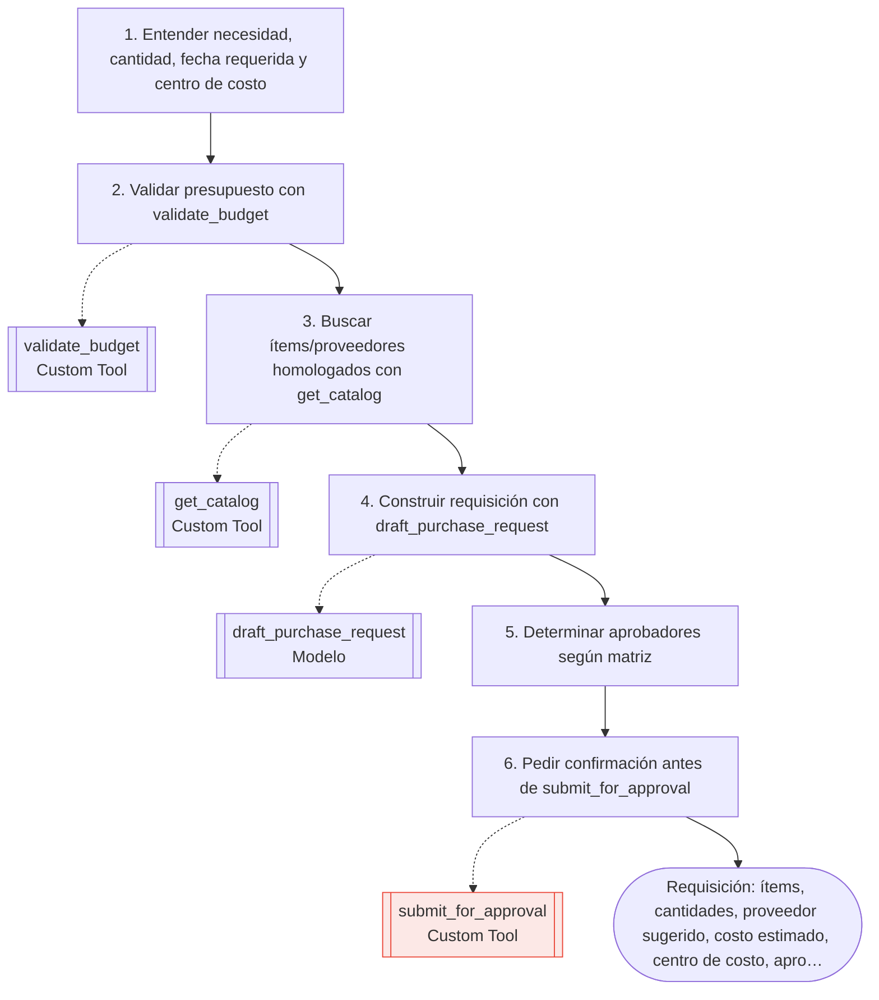

# Arquitectura - Purchase Request Assistant

**Área:** Compras - **Harness:** Deep - **Acceso:** Escritura con aprobación - **Complejidad:** 4/5 (alta) - **Impacto:** 3/5 (medio)

## 1. Arquitectura (inputs → configuración → tools → outputs)

## 2. Secuencia de una ejecución (Gemini Enterprise → A2A → VirtuAI)

## 3. Workflow de la skill principal `purchase-request`

## 4. Matriz de inputs, configuración, tools y outputs

| Inputs | Configuración | Tools | Outputs |
|---|---|---|---|
| Solicitud en lenguaje natural vía Gemini Enterprise Identidad del usuario (OAuth A2A) Tokens OAuth por conector Doc: Política de compras Doc: Catálogo proveedores Doc: Matriz de aprobación | Harness **Deep** Modelo Gemini Pro - T=0.2 System prompt `AGENTS.md` Skills: `purchase-request`, `approval-matrix-check`, `quote-comparison` KB `kb-procurement-assistant` Guardrails: prompt_injection, off_topic Memoria sin PII | `get_catalog` (Custom Tool) `validate_budget` (Custom Tool) `search_requests_mail` (Gmail) `draft_purchase_request` (Modelo) `submit_for_approval` (Custom Tool, Ask) | Requisición estructurada, estimación de costo, checklist y aprobaciones. Worklog y auditoría en VirtuAI Acciones pendientes de aprobación |

## 5. Capas de identidad

1. **Gemini Enterprise** — licencia + rol IAM sobre la app del área.
2. **A2A OAuth** — el usuario consiente `a2a:invoke` en VirtuAI (Authorization Code + PKCE).
3. **Conectores** — OAuth individual por MCP; IAM de servicio para Cloud Run con autorización de negocio en backend.
4. **Datos/acciones** — ACL de origen, RBAC, filas y aprobación humana.
