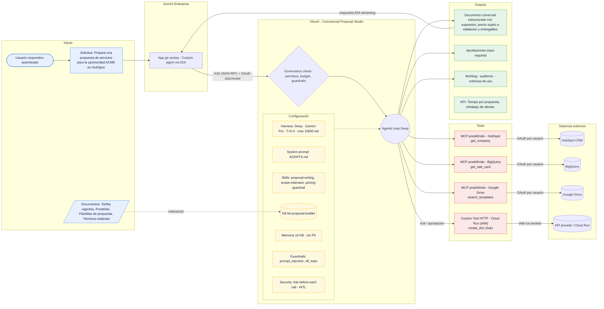
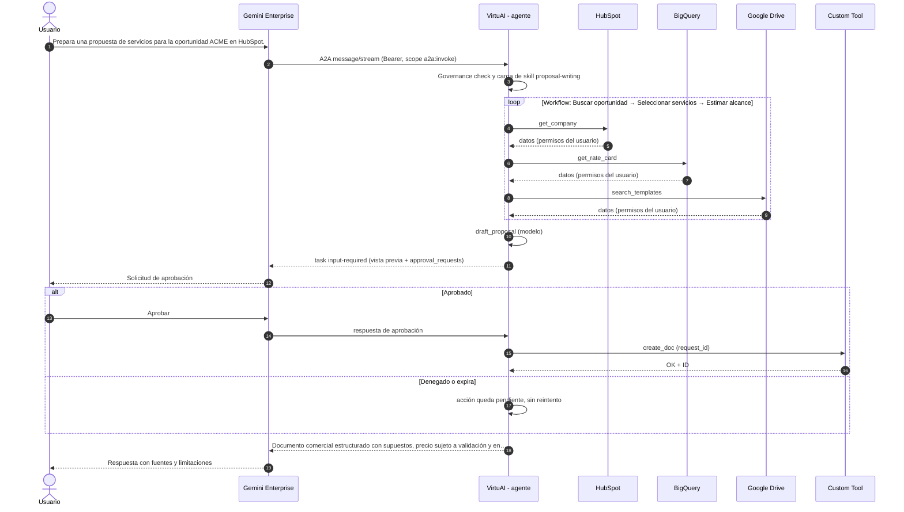
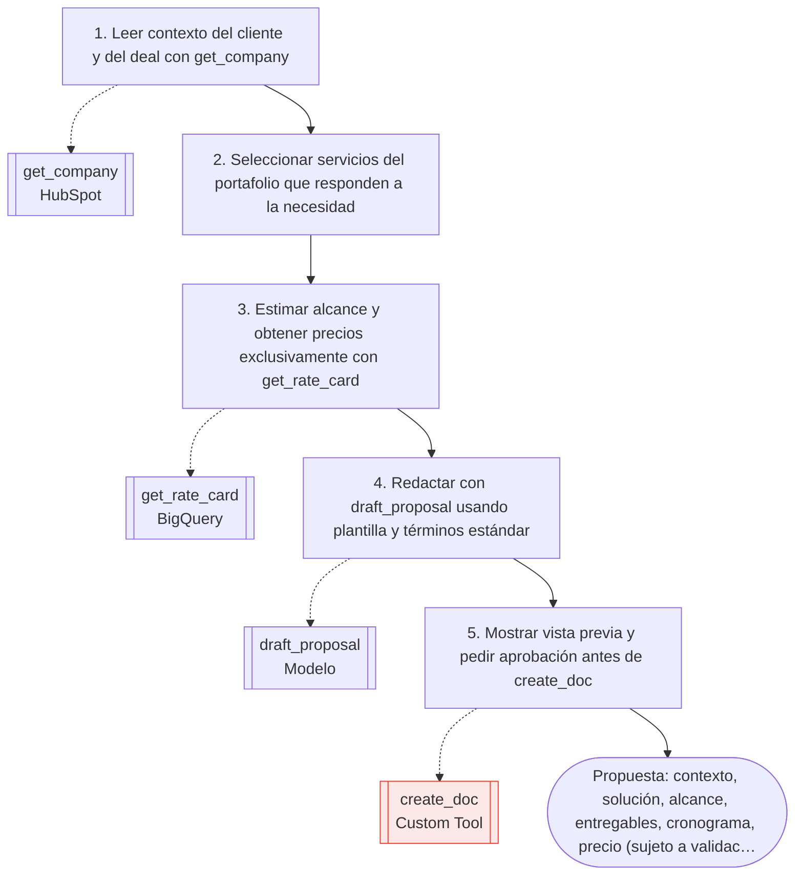

# Arquitectura - Commercial Proposal Studio

**Área:** Ventas - **Harness:** Deep - **Acceso:** Escritura con aprobación - **Complejidad:** 4/5 (alta) - **Impacto:** 4/5 (alto)

## 1. Arquitectura (inputs → configuración → tools → outputs)

## 2. Secuencia de una ejecución (Gemini Enterprise → A2A → VirtuAI)

## 3. Workflow de la skill principal `proposal-writing`

## 4. Matriz de inputs, configuración, tools y outputs

| Inputs | Configuración | Tools | Outputs |
|---|---|---|---|
| Solicitud en lenguaje natural vía Gemini Enterprise Identidad del usuario (OAuth A2A) Tokens OAuth por conector Doc: Tarifas vigentes Doc: Portafolio Doc: Plantillas de propuesta Doc: Términos estándar | Harness **Deep** Modelo Gemini Pro - T=0.4 System prompt `AGENTS.md` Skills: `proposal-writing`, `scope-estimator`, `pricing-guardrail` KB `kb-proposal-builder` Guardrails: prompt_injection, off_topic Memoria sin PII | `get_company` (HubSpot) `get_rate_card` (BigQuery) `search_templates` (Google Drive) `draft_proposal` (Modelo) `create_doc` (Custom Tool, Ask) | Documento comercial estructurado con supuestos, precio sujeto a validación y entregables. Worklog y auditoría en VirtuAI Acciones pendientes de aprobación |

## 5. Capas de identidad

1. **Gemini Enterprise** — licencia + rol IAM sobre la app del área.
2. **A2A OAuth** — el usuario consiente `a2a:invoke` en VirtuAI (Authorization Code + PKCE).
3. **Conectores** — OAuth individual por MCP; IAM de servicio para Cloud Run con autorización de negocio en backend.
4. **Datos/acciones** — ACL de origen, RBAC, filas y aprobación humana.
