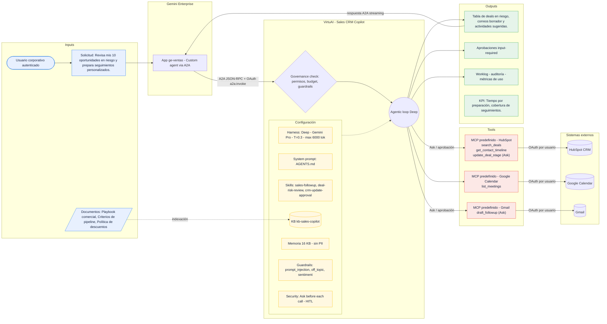
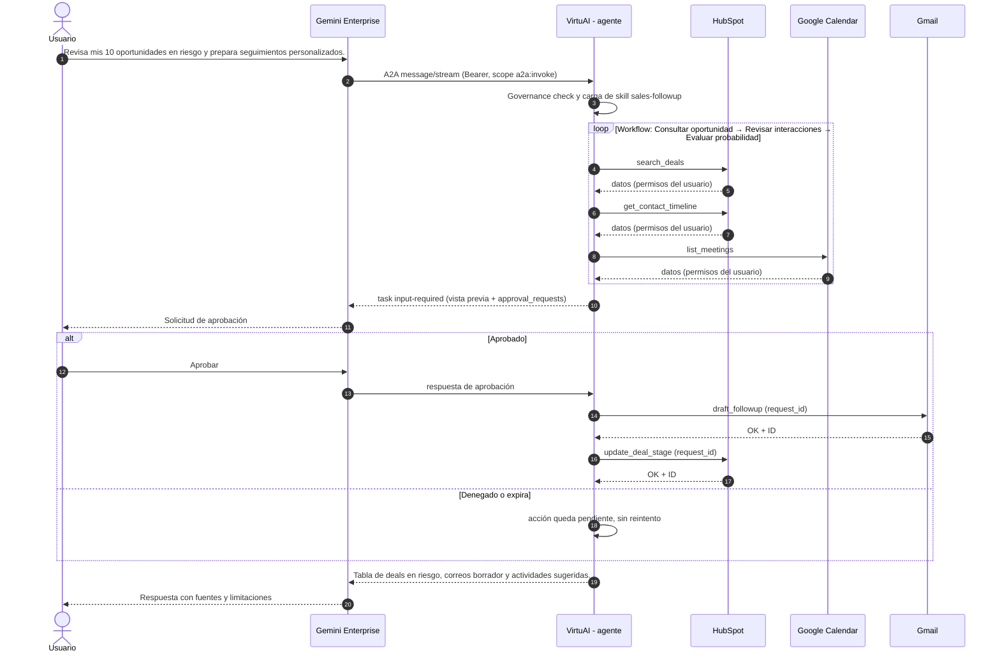
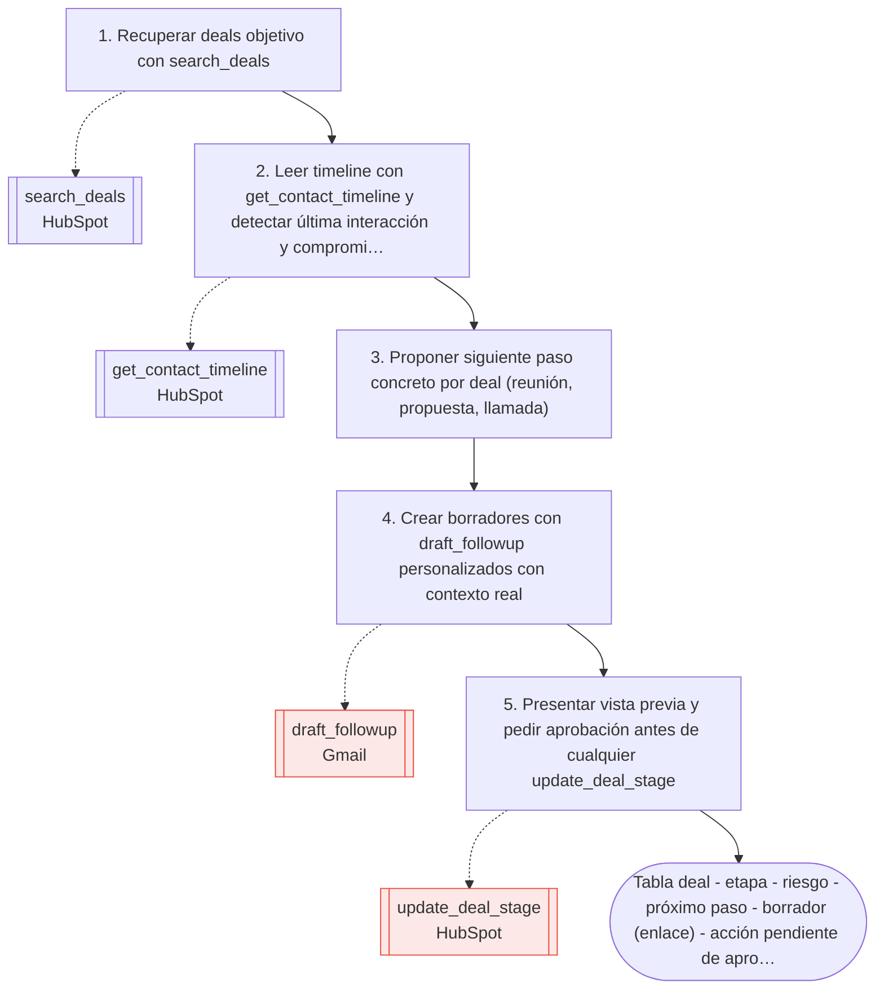

# Arquitectura - Sales CRM Copilot

**Área:** Ventas - **Harness:** Deep - **Acceso:** Escritura con aprobación - **Complejidad:** 3/5 (media) - **Impacto:** 5/5 (muy alto)

## 1. Arquitectura (inputs → configuración → tools → outputs)

## 2. Secuencia de una ejecución (Gemini Enterprise → A2A → VirtuAI)

## 3. Workflow de la skill principal `sales-followup`

## 4. Matriz de inputs, configuración, tools y outputs

| Inputs | Configuración | Tools | Outputs |
|---|---|---|---|
| Solicitud en lenguaje natural vía Gemini Enterprise Identidad del usuario (OAuth A2A) Tokens OAuth por conector Doc: Playbook comercial Doc: Criterios de pipeline Doc: Política de descuentos | Harness **Deep** Modelo Gemini Pro - T=0.3 System prompt `AGENTS.md` Skills: `sales-followup`, `deal-risk-review`, `crm-update-approval` KB `kb-sales-copilot` Guardrails: prompt_injection, off_topic, sentiment Memoria sin PII | `search_deals` (HubSpot) `get_contact_timeline` (HubSpot) `list_meetings` (Google Calendar) `draft_followup` (Gmail, Ask) `update_deal_stage` (HubSpot, Ask) | Tabla de deals en riesgo, correos borrador y actividades sugeridas. Worklog y auditoría en VirtuAI Acciones pendientes de aprobación |

## 5. Capas de identidad

1. **Gemini Enterprise** — licencia + rol IAM sobre la app del área.
2. **A2A OAuth** — el usuario consiente `a2a:invoke` en VirtuAI (Authorization Code + PKCE).
3. **Conectores** — OAuth individual por MCP; IAM de servicio para Cloud Run con autorización de negocio en backend.
4. **Datos/acciones** — ACL de origen, RBAC, filas y aprobación humana.
