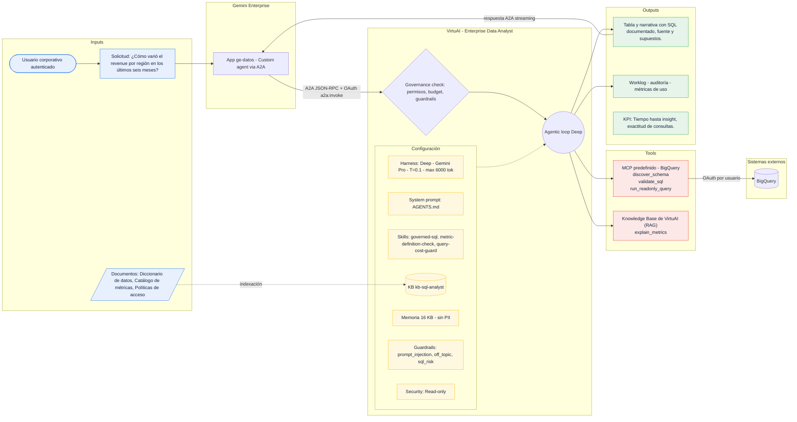
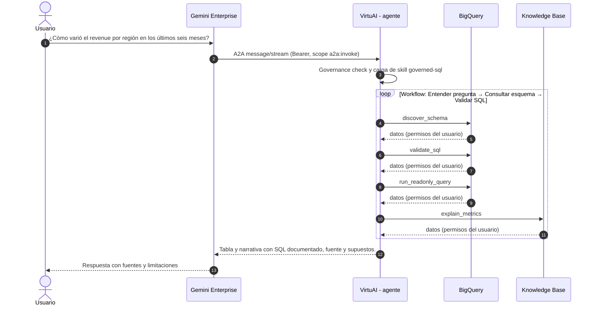
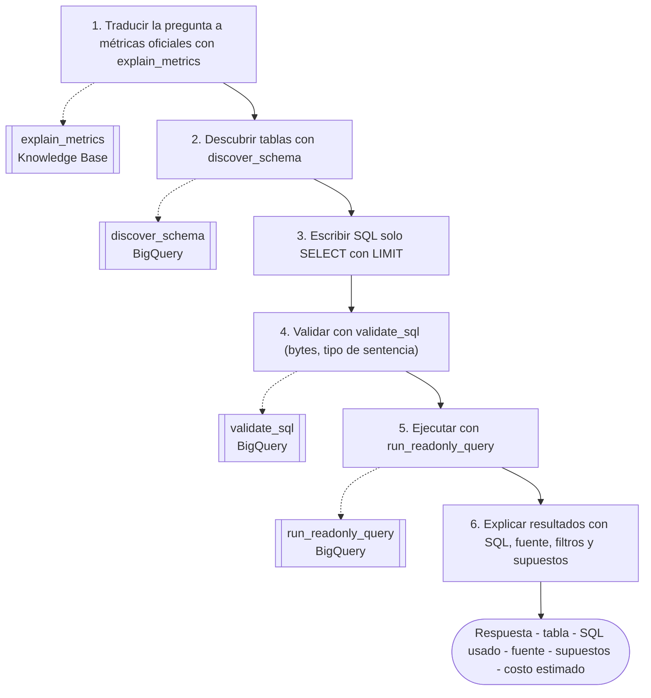

# Arquitectura - Enterprise Data Analyst

**Área:** Datos - **Harness:** Deep - **Acceso:** Lectura - **Complejidad:** 3/5 (media) - **Impacto:** 5/5 (muy alto)

## 1. Arquitectura (inputs → configuración → tools → outputs)

## 2. Secuencia de una ejecución (Gemini Enterprise → A2A → VirtuAI)

## 3. Workflow de la skill principal `governed-sql`

## 4. Matriz de inputs, configuración, tools y outputs

| Inputs | Configuración | Tools | Outputs |
|---|---|---|---|
| Solicitud en lenguaje natural vía Gemini Enterprise Identidad del usuario (OAuth A2A) Tokens OAuth por conector Doc: Diccionario de datos Doc: Catálogo de métricas Doc: Políticas de acceso | Harness **Deep** Modelo Gemini Pro - T=0.1 System prompt `AGENTS.md` Skills: `governed-sql`, `metric-definition-check`, `query-cost-guard` KB `kb-sql-analyst` Guardrails: prompt_injection, off_topic, sql_risk Memoria sin PII | `discover_schema` (BigQuery) `validate_sql` (BigQuery) `run_readonly_query` (BigQuery) `explain_metrics` (Knowledge Base) | Tabla y narrativa con SQL documentado, fuente y supuestos. Worklog y auditoría en VirtuAI Sin efectos en sistemas (solo lectura) |

## 5. Capas de identidad

1. **Gemini Enterprise** — licencia + rol IAM sobre la app del área.
2. **A2A OAuth** — el usuario consiente `a2a:invoke` en VirtuAI (Authorization Code + PKCE).
3. **Conectores** — OAuth individual por MCP; IAM de servicio para Cloud Run con autorización de negocio en backend.
4. **Datos/acciones** — ACL de origen, RBAC, filas y aprobación humana.
