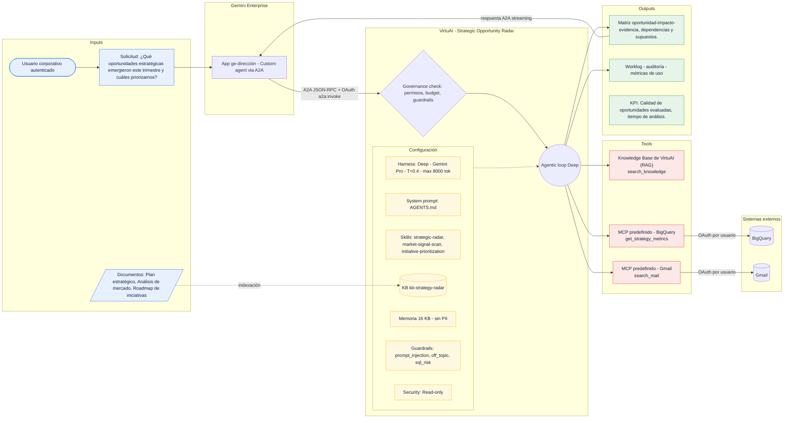
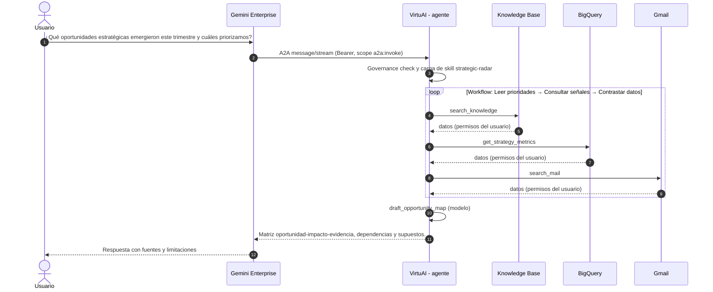
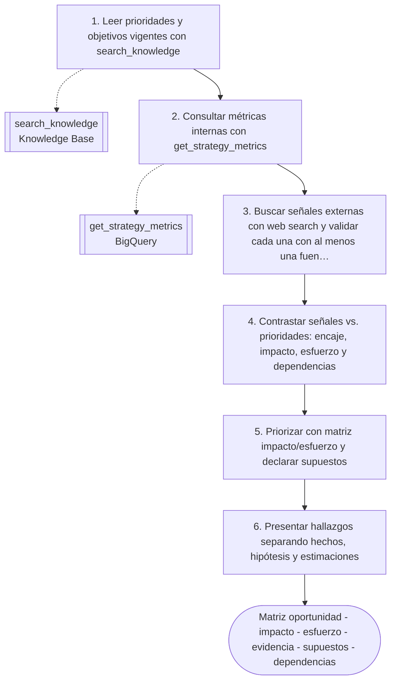

# Arquitectura - Strategic Opportunity Radar

**Área:** Dirección - **Harness:** Deep - **Acceso:** Lectura - **Complejidad:** 3/5 (media) - **Impacto:** 3/5 (medio)

## 1. Arquitectura (inputs → configuración → tools → outputs)

## 2. Secuencia de una ejecución (Gemini Enterprise → A2A → VirtuAI)

## 3. Workflow de la skill principal `strategic-radar`

## 4. Matriz de inputs, configuración, tools y outputs

| Inputs | Configuración | Tools | Outputs |
|---|---|---|---|
| Solicitud en lenguaje natural vía Gemini Enterprise Identidad del usuario (OAuth A2A) Tokens OAuth por conector Doc: Plan estratégico Doc: Análisis de mercado Doc: Roadmap de iniciativas | Harness **Deep** Modelo Gemini Pro - T=0.4 System prompt `AGENTS.md` Skills: `strategic-radar`, `market-signal-scan`, `initiative-prioritization` KB `kb-strategy-radar` Guardrails: prompt_injection, off_topic, sql_risk Memoria sin PII | `search_knowledge` (Knowledge Base) `get_strategy_metrics` (BigQuery) `search_mail` (Gmail) `draft_opportunity_map` (Modelo) | Matriz oportunidad-impacto-evidencia, dependencias y supuestos. Worklog y auditoría en VirtuAI Sin efectos en sistemas (solo lectura) |

## 5. Capas de identidad

1. **Gemini Enterprise** — licencia + rol IAM sobre la app del área.
2. **A2A OAuth** — el usuario consiente `a2a:invoke` en VirtuAI (Authorization Code + PKCE).
3. **Conectores** — OAuth individual por MCP; IAM de servicio para Cloud Run con autorización de negocio en backend.
4. **Datos/acciones** — ACL de origen, RBAC, filas y aprobación humana.
