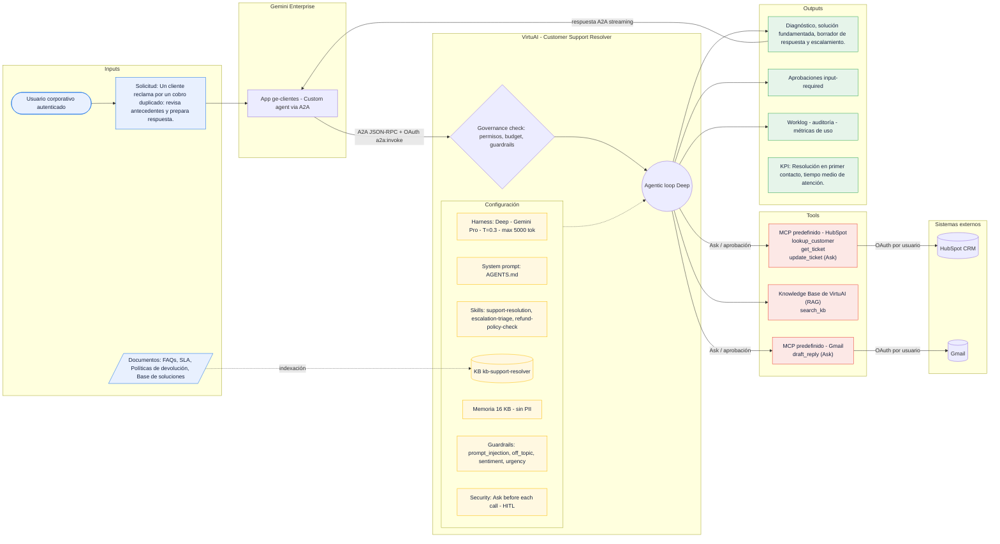
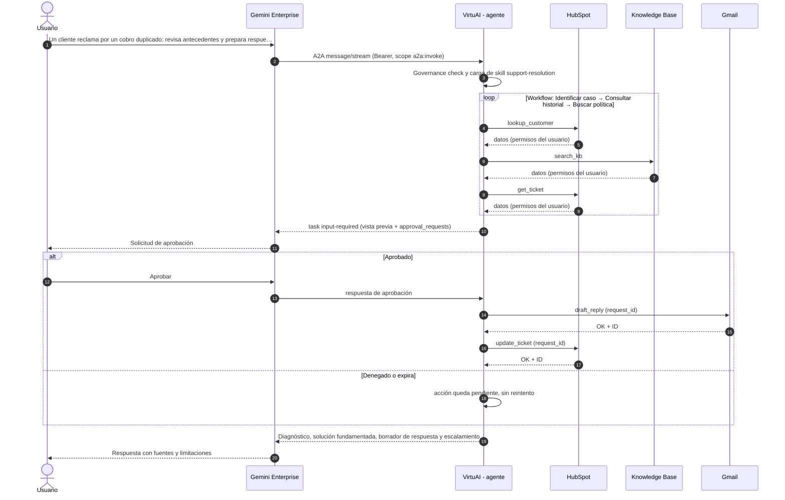
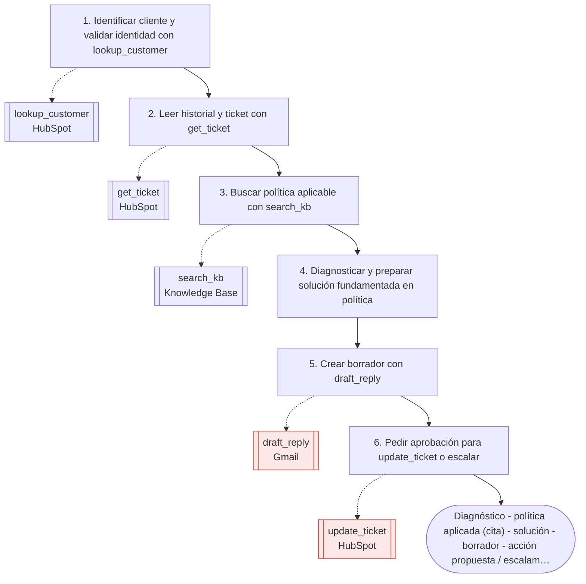

# Arquitectura - Customer Support Resolver

**Área:** Clientes - **Harness:** Deep - **Acceso:** Escritura con aprobación - **Complejidad:** 4/5 (alta) - **Impacto:** 5/5 (muy alto)

## 1. Arquitectura (inputs → configuración → tools → outputs)

## 2. Secuencia de una ejecución (Gemini Enterprise → A2A → VirtuAI)

## 3. Workflow de la skill principal `support-resolution`

## 4. Matriz de inputs, configuración, tools y outputs

| Inputs | Configuración | Tools | Outputs |
|---|---|---|---|
| Solicitud en lenguaje natural vía Gemini Enterprise Identidad del usuario (OAuth A2A) Tokens OAuth por conector Doc: FAQs Doc: SLA Doc: Políticas de devolución Doc: Base de soluciones | Harness **Deep** Modelo Gemini Pro - T=0.3 System prompt `AGENTS.md` Skills: `support-resolution`, `escalation-triage`, `refund-policy-check` KB `kb-support-resolver` Guardrails: prompt_injection, off_topic, sentiment, urgency Memoria sin PII | `lookup_customer` (HubSpot) `search_kb` (Knowledge Base) `get_ticket` (HubSpot) `draft_reply` (Gmail, Ask) `update_ticket` (HubSpot, Ask) | Diagnóstico, solución fundamentada, borrador de respuesta y escalamiento. Worklog y auditoría en VirtuAI Acciones pendientes de aprobación |

## 5. Capas de identidad

1. **Gemini Enterprise** — licencia + rol IAM sobre la app del área.
2. **A2A OAuth** — el usuario consiente `a2a:invoke` en VirtuAI (Authorization Code + PKCE).
3. **Conectores** — OAuth individual por MCP; IAM de servicio para Cloud Run con autorización de negocio en backend.
4. **Datos/acciones** — ACL de origen, RBAC, filas y aprobación humana.
