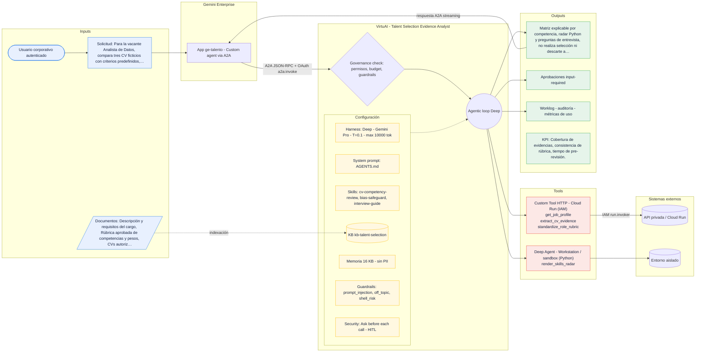
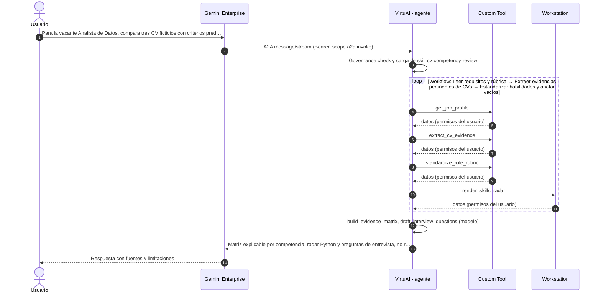
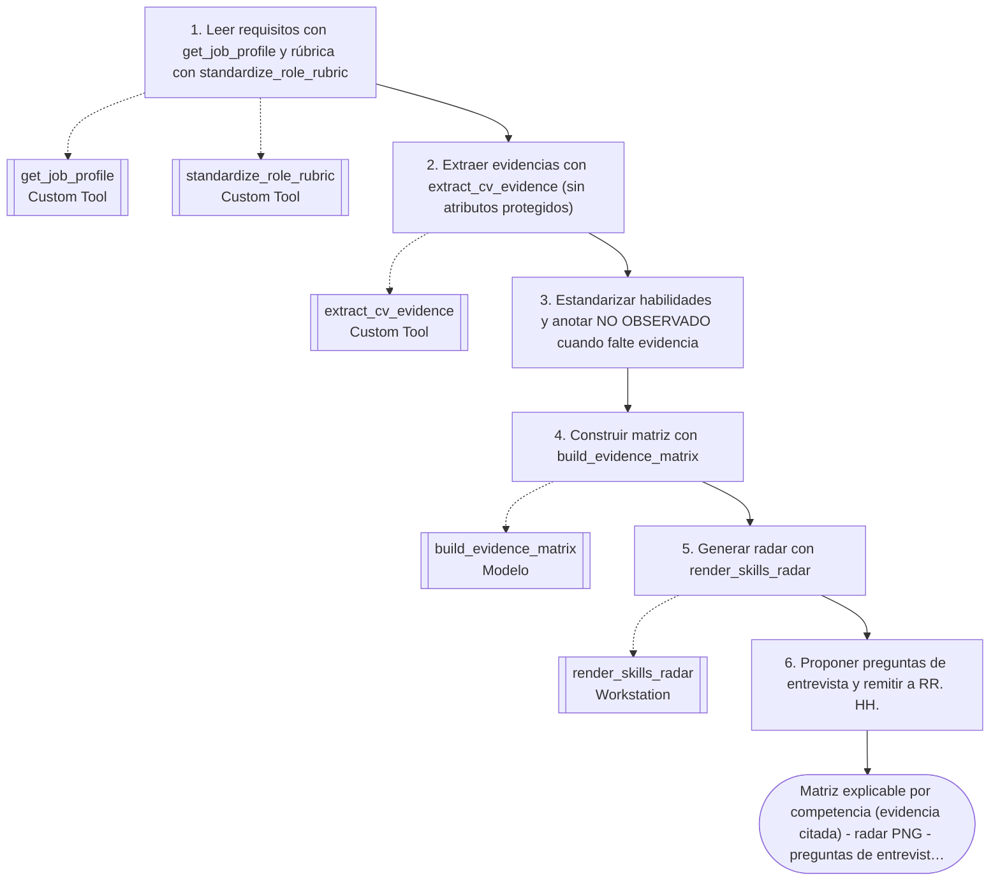

# Arquitectura - Talent Selection Evidence Analyst

**Área:** Talento - **Harness:** Deep - **Acceso:** Escritura con aprobación - **Complejidad:** 5/5 (muy alta) - **Impacto:** 3/5 (medio)

## 1. Arquitectura (inputs → configuración → tools → outputs)

## 2. Secuencia de una ejecución (Gemini Enterprise → A2A → VirtuAI)

## 3. Workflow de la skill principal `cv-competency-review`

## 4. Matriz de inputs, configuración, tools y outputs

| Inputs | Configuración | Tools | Outputs |
|---|---|---|---|
| Solicitud en lenguaje natural vía Gemini Enterprise Identidad del usuario (OAuth A2A) Tokens OAuth por conector Doc: Descripción y requisitos del cargo Doc: Rúbrica aprobada de competencias y pesos Doc: CVs autorizados y minimizados Doc: Matriz de evidencias Doc: Política de datos de candidatos | Harness **Deep** Modelo Gemini Pro - T=0.1 System prompt `AGENTS.md` Skills: `cv-competency-review`, `bias-safeguard`, `interview-guide` KB `kb-talent-selection` Guardrails: prompt_injection, off_topic, shell_risk Memoria sin PII | `get_job_profile` (Custom Tool) `extract_cv_evidence` (Custom Tool) `standardize_role_rubric` (Custom Tool) `build_evidence_matrix` (Modelo) `render_skills_radar` (Workstation, Ask) `draft_interview_questions` (Modelo) | Matriz explicable por competencia, radar Python y preguntas de entrevista; no realiza selección ni descarte automático. Worklog y auditoría en VirtuAI Acciones pendientes de aprobación |

## 5. Capas de identidad

1. **Gemini Enterprise** — licencia + rol IAM sobre la app del área.
2. **A2A OAuth** — el usuario consiente `a2a:invoke` en VirtuAI (Authorization Code + PKCE).
3. **Conectores** — OAuth individual por MCP; IAM de servicio para Cloud Run con autorización de negocio en backend.
4. **Datos/acciones** — ACL de origen, RBAC, filas y aprobación humana.
